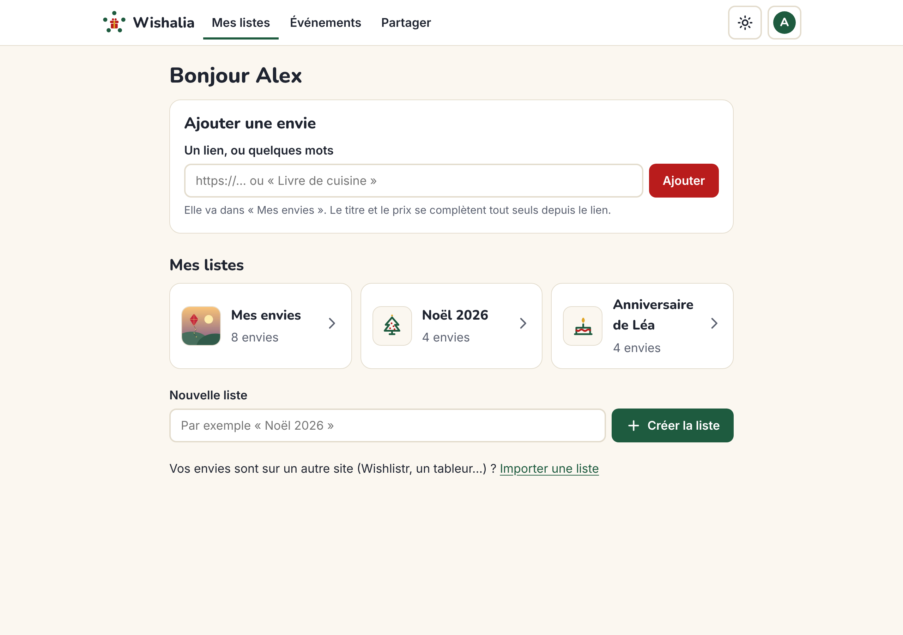

<p align="center">
  <picture>
    <source media="(prefers-color-scheme: dark)" srcset="docs/images/logo-dark.svg">
    
  </picture>
</p>

<h1 align="center">Wishalia</h1>

<p align="center">
  <strong>Self-hosted wishlists for a family: events, shared gifts, and a strict anti-spoil rule.</strong>
</p>

<p align="center">
  <a href="https://arcanexus.github.io/wishalia/"><strong>Website</strong></a> ·
  <a href="https://github.com/Arcanexus/wishalia/wiki"><strong>Documentation</strong></a> ·
  <a href="https://github.com/Arcanexus/wishalia/releases"><strong>Releases</strong></a>
</p>

<p align="center">
  <a href="https://github.com/Arcanexus/wishalia/releases"></a>
  <a href="https://github.com/Arcanexus/wishalia/actions/workflows/docker-publish.yml"></a>
  <a href="https://github.com/Arcanexus/wishalia/actions/workflows/tests.yml"></a>
  <a href="https://github.com/Arcanexus/wishalia/actions/workflows/tests.yml"></a>
  <a href="https://github.com/Arcanexus/wishalia/actions/workflows/codeql.yml"></a>
  <a href="LICENSE"></a>
</p>

---

Wishalia lets a family keep several wishlists, pick items for recurring events (birthdays,
Christmas), and chip in together for the same gift. Its core promise: **the owner of a list never
sees who gave what**, until they lift the secret after the event. The rule is enforced on the
server, not hidden in the page.

> **Status:** latest release, [v0.0.5](https://github.com/Arcanexus/wishalia/releases/tag/v0.0.5): early, for trying at home. The four components build, test, ship as images and deploy with the Helm
> chart. The data model, the business rules (funding, anti-spoil), the sign-in (OIDC, passkeys,
> magic links), the management API, the public view API (share links, contributions) and the REST
> API v1 (personal access tokens, OpenAPI) are in place and tested. The management app has its
> screens (signing in, passkeys, lists, quick add, editing and reordering items, a list's preview,
> events, sharing, settings), and the family sees a shared list or event in the public view, where
> they reserve a gift, share any gift that has a price by giving part of it, chip in to a pool, and withdraw. The public host's home page welcomes visitors, signs them in,
> and finds the lists their owners made public. The worker completes the items added with a link (title,
> price, images; Amazon included), each step showing up live on the owner's and the guests' pages with no reload, and reads them again on demand, keeping what the owner typed, and the owner can choose, send and frame the image of each item (on a volume or in S3, through imgproxy).
> The app installs on a phone, and a wish comes in from the share menu of any app (a Shortcut on iPhone).
> Lists kept elsewhere come in by import: Wishlistr, a CSV or JSON file, or pasted text.
> Everything speaks French and English, with dates and amounts in the reader's format.

<p align="center">
  
</p>

|                          |                                                                          |
| ------------------------ | ------------------------------------------------------------------------ |
| 🤫 **Nothing spoiled**   | No amount, name or progress shown to the owner, link previews included.  |
| 🎁 **Gifts together**    | Several contributions per item, across events, overshoot allowed.        |
| 🔎 **Private or public** | Private lists by link only; public ones found from the home page.        |
| 📅 **Lists and events**  | Durable lists, recurring events, series of books, recurring wishes.      |
| 👵 **For every age**     | Large touch targets, no password, an item added in under five seconds.   |
| 📱 **On the phone**      | Installs like an app; « Partager » from any shop adds a wish.            |
| 📥 **Bring your lists**  | Import from Wishlistr, a CSV or JSON export, or a pasted list.           |
| 🌍 **Your language**     | French and English, chosen by the browser or in the settings.            |
| ⚡ **Light**             | Little JavaScript, quick on a modest phone.                              |
| 🏠 **Self-hosted**       | Four images, one Helm chart (PostgreSQL included, or yours), a REST API. |
| 📈 **Observable**        | Prometheus metrics and a ServiceMonitor, with nothing that spoils.       |

## Quick start

```sh
corepack enable && pnpm install
docker compose up -d
pnpm dev
```

See the [quick start](docs/quick-start.md), the [installation on Kubernetes](docs/installation.md),
the [architecture](docs/architecture.md), the [data model](docs/data-model.md),
[authentication](docs/authentication.md), the [management app](docs/management-app.md),
[installing the app on a phone](docs/install-app.md), [languages](docs/i18n.md), the
[management API](docs/api.md) and
[monitoring](docs/monitoring.md).

## Contributing

Read [CONTRIBUTING.md](CONTRIBUTING.md) and [docs/development.md](docs/development.md). Security
issues: [SECURITY.md](SECURITY.md).

## License

[Apache-2.0](LICENSE)
