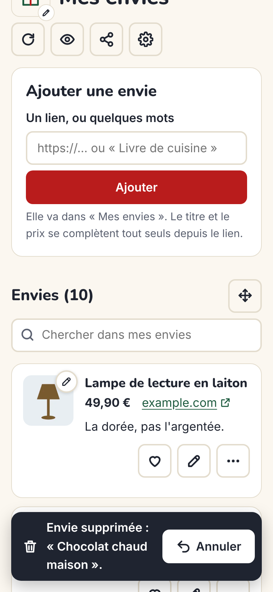
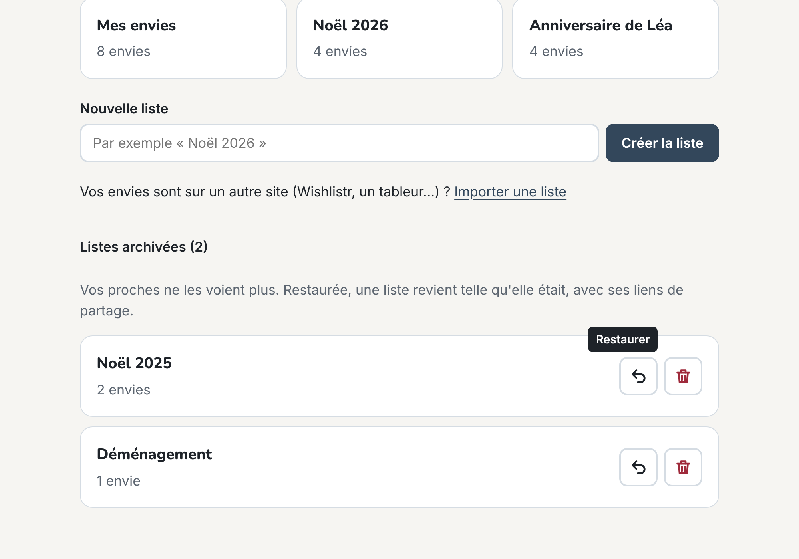
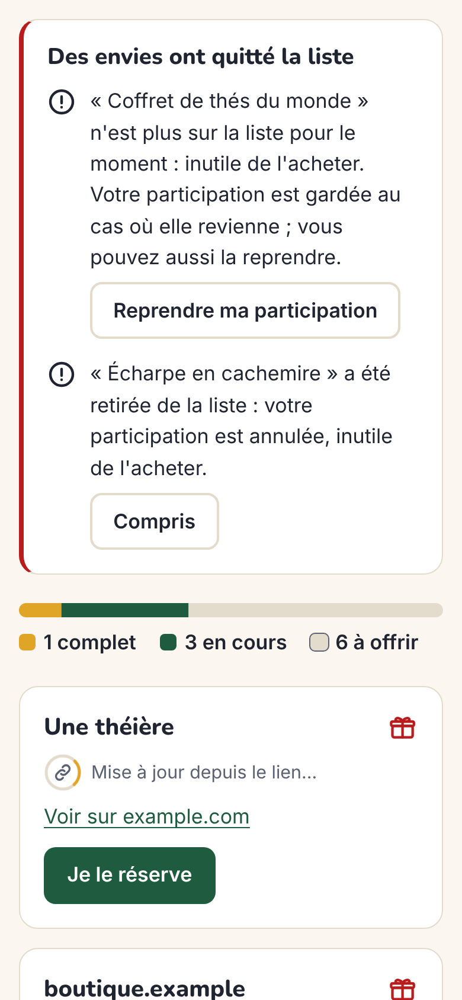

# Archiving and deleting

Every list and every item can be **archived** (hidden, and restorable) or **deleted** (for good).
Both are always possible, whatever was given: refusing, or even warning the owner that someone
meant to give it, would give the gift away ([anti-spoil](security.md)). The guests who meant to give
it are the ones who are told, on their own link.

|                         | Archived                                                    | Deleted                                         |
| ----------------------- | ----------------------------------------------------------- | ----------------------------------------------- |
| The owner               | Under « Reçues et archivées » or « Listes archivées »       | Gone from every screen and from the API (`404`) |
| The guests              | No longer see it                                            | No longer see it                                |
| Gifts pledged to it     | Kept, in case it comes back; the guest may take theirs back | Cancelled                                       |
| Images                  | Kept                                                        | Removed, files included                         |
| Events                  | Kept                                                        | It leaves them                                  |
| Share links (of a list) | Open nothing while archived                                 | Revoked                                         |
| Back                    | One tap: restored as it was                                 | Never                                           |

## In the management app

On a list page, each item has its buttons as icons, with their words on hover and on keyboard focus:

- the box, « Archiver »: the item goes under « Reçues et archivées »;
- the bin, « Supprimer », in the colour of danger (in the card's « ⋯ » menu): the wish leaves the
  screen at once, with no dialog, and a message at the foot of the screen says « Envie supprimée :
  « Lampe ». » with **« Annuler »** for eight seconds. « Annuler » brings it back as it was: nothing
  was sent, and no guest was told. The time stops while the message is pointed at or has the focus
  (WCAG 2.2.1); a new deletion, leaving the page or hiding the tab sends the one waiting. Once the
  time is up, the deletion goes to the server like any change saved in the background, and is final:
  relatives who meant to give it are told on their link. A series and a volume are deleted the same
  way.

Under « Reçues et archivées », the arrow coming back (« Remettre dans la liste ») restores an item,
and the bin deletes it the same way.

A list is archived from its settings (« Archiver la liste », behind a box to tick). It then waits on
the home page under « Listes archivées », folded, with the arrow to restore it (with its items,
settings and share links, as it was) and the bin to delete it. A list's bin keeps its dialog, which
says what goes and that it cannot be undone, « Annuler » first with the focus. « Supprimer la liste », at the end
of the list's settings, deletes it directly, behind a box to tick.

## On the guests' side

An archived or deleted item leaves the guests' view at once, on the list's links and on the events'.
An archived list's links open nothing until it is restored; a deleted list's links are revoked.

A guest who had pledged something to an item that left the list is told at the top of their link,
in « Des envies ont quitté la liste », so that they do not buy it:

- **archived**: « « Vélo » n'est plus sur la liste pour le moment : inutile de l'acheter. Votre
  participation est gardée au cas où elle revienne ; vous pouvez aussi la reprendre. »
  « Reprendre ma participation » takes it back, with the same rules as « Me retirer ». Restored,
  the item comes back with the gifts that were kept;
- **deleted**: « « Vélo » a été retirée de la liste : votre participation est annulée, inutile de
  l'acheter. », said for 30 days. « Compris » makes this device forget it.

Only the person's own gifts are said: those of their account, and those their device proves with
the withdraw key it keeps ([Withdrawing](public-view.md#withdrawing)). Nobody learns anything about
someone else's gifts, and the owner learns nothing at all.

## What stays

The history of an item is append-only ([Data model](data-model.md)): a deletion adds a `deleted`
entry, and each gift it cancels a sealed `contribution_withdrawn` entry with `reason: "item_deleted"`.
So the rows of a deleted item and list stay, marked `deleted_at`, with their title (for the guests'
notice); the item's link, notes, images and place in the events go. Nothing shows them again.

## Right away, the files after

Once « Supprimer définitivement » is confirmed, the dialog closes and the wish leaves the page at
once, without waiting for the server (the keyboard goes to the list's heading); the deletion is
saved in the background and goes again by itself if the network or the server is away
([Management app](management-app.md), « Saved in the background »). Should the server refuse it,
the wish comes back with a message. On the server, the deletion is one transaction: the rows
are marked, the gifts cancelled and the guests' notice written together, so the anti-spoil rules
hold at every moment. The image files are removed **after** the answer, in the background: the
person never waits for the bucket or the volume. A file that could not be removed then (the bucket
did not answer, the server stopped) names no image any more, so the worker's periodic cleanup
removes it a little later ([Images](images.md), « Unused files »).

## API

| Route                                    | What                                                                                       |
| ---------------------------------------- | ------------------------------------------------------------------------------------------ |
| `PATCH /manage/items/:id` `{ status }`   | `archived` archives, `open` restores.                                                      |
| `DELETE /manage/items/:id`               | `204`: deleted for good. `404` once deleted.                                               |
| `PATCH /manage/lists/:id` `{ archived }` | `true` archives, `false` restores.                                                         |
| `GET /manage/lists?archived=true`        | The archived lists, never the deleted ones.                                                |
| `DELETE /manage/lists/:id`               | `204`: the list and its items, deleted for good. `404` once deleted.                       |
| `POST /public/gifts/gone`                | The person's own gifts whose item left the list ([Public view API](public-api.md#routes)). |

The [REST API v1](rest-api.md) has the same `GET`, `PATCH` and `DELETE` routes, with a token that
is not read-only.
