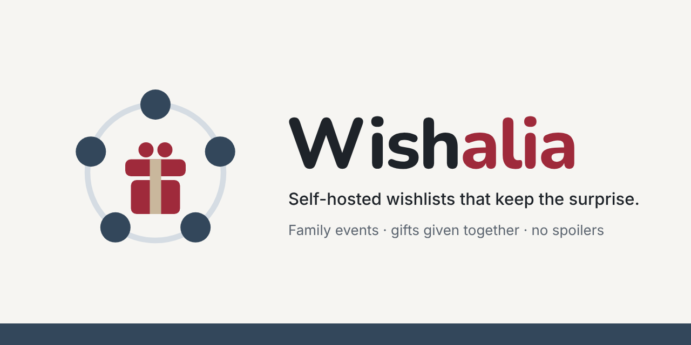

# Branding

The product is called **Wishalia**, and so is everything technical: repository, packages
(`@wishalia/*`), images, Helm chart, cookies (`wishalia.*`) and metrics (`wishalia_`). The name shown
to people comes from `APP_NAME` (chart: `config.appName`), with `Wishalia` as the default.

## Logo

Five relatives in a circle around a gift: the family gathers around the present. The source is
[`images/logo.svg`](images/logo.svg) (96 × 96 viewBox).

- The five heads sit on a thin ring that joins them. Keep the ring: at small sizes (favicon, app
  header) it may be dropped, never the heads or the gift.
- The gift has a lid, a box, a ribbon and a two-loop bow.
- Variants: app icon (white heads on the action colour), single colour (one ink colour, white
  ribbon), and the Christmas variant where the ring becomes a holly wreath with berries.
- Leave at least a quarter of the logo's width of free space around it.
- On a dark background, use [`images/logo-dark.svg`](images/logo-dark.svg) (dark neutral palette).
  The README and the website switch between the two with `prefers-color-scheme`.

## Social preview

The image shown when a link to the repository or the website is shared (1280 × 640, GitHub's
recommended size): logo, wordmark and tagline on the light neutral background. The source is
[`images/social-preview.svg`](images/social-preview.svg); the PNG is rendered from it with Nunito
and Inter. The website points to it in its Open Graph tags. For the repository, it is uploaded by
hand in **Settings › General › Social preview** (GitHub has no API for it).

## Themes

Two themes, each in light and dark. **Neutral** is the default, all year round and for every event
(birthday, birth…). **Christmas** replaces it for a list tied to a Christmas event, or in December.
The app follows the device setting (`prefers-color-scheme`); a button in the header forces light or
dark, and the choice is remembered.

### Theme settings

Each person manages their themes in the settings of the apps (management app and public view):

- **Theme**: `Automatic` (default: Christmas for a Christmas list or in December, neutral
  otherwise), `Neutral` or `Christmas`.
- **Mode**: `Same as my device` (default), `Light` or `Dark`. The header button is a shortcut to
  this setting.

The owner of a list can also **force a theme for that list** in the list's settings: `None`
(default, each person's choice applies), `Neutral` or `Christmas`. A forced theme applies to
everyone who opens the list, owner and guests, over their own theme setting. The mode always stays
personal: a forced theme is shown in light or dark according to each person's mode, so nobody loses
the contrast they need.

Order, from strongest: the list's forced theme, then the person's theme, then `Automatic`. A
person's settings are stored with their account when there is one, and on the device otherwise
(guests on their nominative link).

Every text colour below meets WCAG 2.2 AA (4.5:1) on the background it is used on. Decorative
colours (logo ring, ribbon, progress bars) are never used for text.

### Neutral

| Role               | Light                 | Dark                  | Contrast (light / dark)    |
| ------------------ | --------------------- | --------------------- | -------------------------- |
| Background         | `#F6F5F2`             | `#15181C`             |                            |
| Surface (cards)    | `#FFFFFF`             | `#1E232A`             |                            |
| Text               | `#1E2329`             | `#EEF0F2`             | 15:1 / 16:1                |
| Secondary text     | `#5C6570`             | `#A3ACB7`             | 5.5:1 / 6.8:1              |
| Action (buttons)   | `#33475B`             | `#4A6A8A`             | white on it: 9.6:1 / 5.6:1 |
| Link               | `#33475B`             | `#A9C4E0`             |                            |
| Accent (gift, CTA) | `#9F2A3B`             | `#B23A4B`             | white on it: 7.2:1 / 5.7:1 |
| Progress (pots)    | `#5B7A99`             | `#8FB0D0`             | decorative                 |
| Logo heads         | `#33475B`             | `#A9C4E0`             |                            |
| Logo gift / ribbon | `#9F2A3B` / `#C9B79C` | `#D46A78` / `#D9C9AE` | decorative                 |

### Christmas

| Role               | Light                 | Dark                  | Contrast (light / dark)    |
| ------------------ | --------------------- | --------------------- | -------------------------- |
| Background         | `#FBF7F0`             | `#121815`             |                            |
| Surface (cards)    | `#FFFFFF`             | `#1C2621`             |                            |
| Text               | `#1F2430`             | `#F4F1EA`             | 15:1 / 16:1                |
| Secondary text     | `#5B6170`             | `#A9B5AE`             | 6:1 / 8:1                  |
| Action (buttons)   | `#1E5B3F`             | `#2E7D57`             | white on it: 8.0:1 / 5.0:1 |
| Link               | `#1E5B3F`             | `#8FD3AE`             |                            |
| Accent (gift, CTA) | `#B91C1C`             | `#C53030`             | white on it: 6.5:1 / 5.3:1 |
| Progress (pots)    | `#E0A526`             | `#E8B53A`             | decorative                 |
| Logo heads         | `#1E5B3F`             | `#8FD3AE`             |                            |
| Logo gift / ribbon | `#B91C1C` / `#E0A526` | `#E5484D` / `#F3C969` | decorative                 |

Red and green also differ in lightness, so people with a colour-vision deficiency still tell them
apart.

## Fonts

- Headings and the wordmark: **Nunito** (800 for the wordmark, 700–800 for titles). Rounded and
  friendly, readable at every age.
- Body text and the interface: **Inter** (400–600).
- Both are under the SIL Open Font License. The apps must serve them themselves (no third-party
  font request, in line with the strict CSP).

## Wordmark

`Wish` in the text colour followed by `alia` in the accent colour, set in Nunito 800 with a slight
negative letter spacing (−0.02em). Beside the logo, the wordmark's cap height matches about half the
logo's height.
