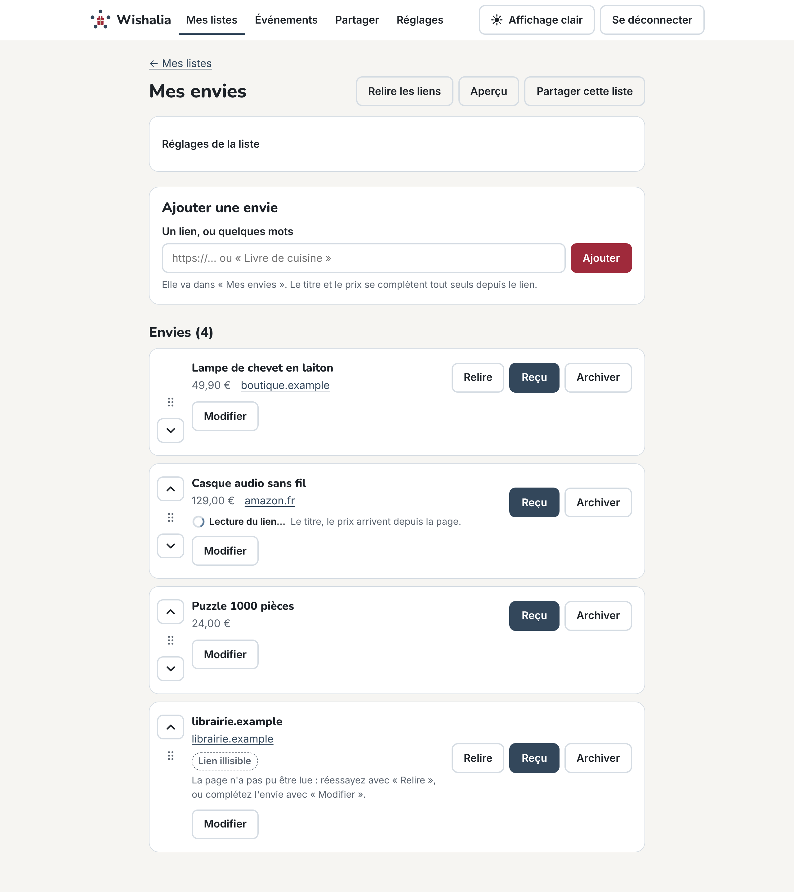

# Completing items from their link

When an item is added with a link, it shows at once with the site's name as its title (« fnac.com »).
The worker then reads the page behind the link and completes the item: its **title**, its
**price** and its **images** ([Images](images.md)). Meanwhile the item shows a turning icon and
« Lecture du lien… » (and, with images on, an empty frame where its image will go, that breathes;
both stay still when the device asks for less motion), and the list page looks again: every 3 seconds for the first minute, then
every 15 seconds, for 10 minutes at most. A link that could not be read says « Lien illisible ».

## What is read

In cascade, each piece of information from the first source that has it (spec §5.3):

1. the JSON-LD `schema.org/Product` of the page (`name`, `offers.price`, `priceCurrency`, the lowest
   price of an `AggregateOffer`), also inside a `@graph`;
2. the Open Graph and Twitter tags (`og:title`, `twitter:title`, `product:price:amount`,
   `product:price:currency`);
3. the price shown in the page itself, for the shops that write neither (see below), then the
   microdata `itemprop="price"` and `itemprop="priceCurrency"`;
4. the page's `<title>`.

Only a title and a price are kept, as text and a number: no HTML of the page is ever stored or shown.
Prices are read as pages write them (`49.9`, `49,90 €`, `1 299,00`, `1,299.00`). A price in another
currency than the euro is left out.

### Amazon

Amazon (amazon.fr and the other countries) writes no JSON-LD and no price tag: the worker reads the
product's title (`#productTitle`) and the price to pay as the page shows it, in this order:

1. in the price block (`corePriceDisplay_desktop_feature_div`, `corePrice_feature_div`,
   `apex_desktop` and the older `priceblock_*`), the price to pay (`priceToPay`), from its hidden
   text for screen readers (`a-offscreen`) or from its whole and fraction parts; the struck-out
   « Prix conseillé » after it is never taken;
2. the hidden fields of the « Ajouter au panier » form (`attach-base-product-price`,
   `customerVisiblePrice`);
3. the data of the variants' selector (`twister-plus-price-data-price`, `priceAmount`).

The currency comes with the price (`€`, `EUR`): an amazon.com price in dollars is left out, like
any price that is not in euros. A range (« 19,99 € - 29,99 € ») gives its lowest price.

### Walls against robots

Some shops answer a program with a wall instead of the product: Amazon's « Continuer les achats »
CAPTCHA, a « Robot Check », a Cloudflare or DataDome challenge. The worker recognises these pages
and takes them for a page not read yet: it tries again later (1, then 2 minutes after), and after
3 attempts the item says « Lien illisible » instead of keeping a title or a price from the wall.
The worker never tries to get past a wall: it says who it is (`Wishalia/1.0` in its user agent).
When a shop keeps refusing it, the price is typed with « Modifier ».

## Reading a link again

A page changes: a new price, a better photo, or a reader that improved since the item came in (the
Amazon photo, for one). The owner asks for a new read, from the list page:

- **« Relire »** on an item reads its link again;
- **« Relire les liens »**, next to « Aperçu », reads again the links of every open item of the list.

The items show « Lecture du lien… » again, and the page looks again, as for a new item. A link that
said « Lien illisible » can be tried again the same way. What the owner typed or sent is kept (see
below): the read only follows the page where the item still has what the page gave.

So that no site gets a burst of requests, and nobody can use Wishalia to hammer one:

- the items of a same site are spaced 5 seconds apart (the others go side by side): a list of 20
  Amazon wishes takes under two minutes;
- each owner may ask 30 item reads and 3 list reads per minute (`429 rate_limited` beyond, and the
  page asks to try again in a minute);
- an item being read already is left as it is.

Each request writes a `refresh_requested` entry to the item's history (owner only). API:
`POST /manage/items/:id/refresh` and `POST /manage/lists/:id/refresh`, also in the
[REST API v1](rest-api.md).

## The owner's words win

- The title is replaced only while it is still the site's name, or the title the page gave the last
  time: words typed with the link, or a title changed since, are kept.
- The price fills an empty one, or follows the page while it is still the price the page gave the
  last time; a price the owner typed or changed is kept. A page that no longer shows a price leaves
  the item's.
- The page's images replace the page's older ones; a photo the owner sent stays, and stays shown when
  they chose it. A frame drawn on a page image starts again on the new one.
- When the owner changes the item while the page loads, the worker applies the rules to the item as
  it is then. When they change its link, the item is queued again for the new link and the old
  result is dropped.

The worker keeps what it wrote (`found_title`, `found_price_cents`), to tell the page's values from
the owner's. Each completion writes an `enriched` entry to the item's history (visible to the owner only), with
what changed.

## Safety

The link comes from the owner, so reading it must never open a way into the cluster or the home
network (server-side request forgery). The worker:

- only reads `http` and `https` links, on the standard ports, without credentials in the link;
- refuses local names (`localhost`, `*.local`, `*.internal`) and every non-public address
  (loopback, private, link-local, carrier-grade NAT, reserved, multicast, IPv4 written as IPv6),
  checked on the address actually connected to, after the DNS answer, so a name that resolves
  inside is refused too;
- checks every redirect again, and follows five at most;
- stops after 10 seconds and 3 MB, and only reads HTML.

## The queue

The queue is the `enrichment` column of the items, in PostgreSQL: `pending` when there is a link to
read, then `running`, `done` or `failed`. The worker takes the oldest pending item with
`FOR UPDATE SKIP LOCKED`, so several replicas never take the same one. A page that cannot be read
is tried again later (1, then 2 minutes after), and the item is `failed` after 3 attempts, or at
once for a refused address; an item may also wait for a later time (`enrichment_at`), when a list's
links are read again; the page then says the link could not be read, and the item stays as
it was. A run whose worker stopped is taken again after 2 minutes.

The worker needs `DATABASE_URL` (see [Configuration](configuration.md)) and outgoing HTTP(S) access to
the Internet. Its metrics are described in [Monitoring](monitoring.md).

The worker also takes up to four images from the page, through the same guard, when the images
are configured (a volume or a bucket): see [Images](images.md).

Coming next: more site-specific readers, and a headless browser as a last resort.
