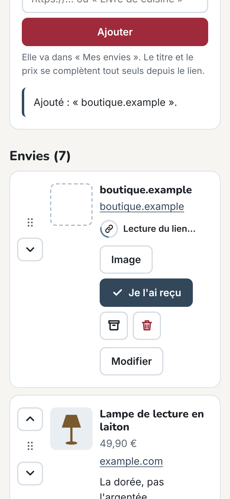

# Completing items from their link

When an item is added with a link, it shows at once with the site's name as its title (« fnac.com »).
The worker then reads the page behind the link and completes the item: its **title**, its
**price** and its **images** ([Images](images.md)). The list page says « Le titre et le prix se complètent depuis le lien… » meanwhile, and
looks again every few seconds, for a minute at most.

## What is read

In cascade, each piece of information from the first source that has it (spec §5.3):

1. the JSON-LD `schema.org/Product` of the page (`name`, `offers.price`, `priceCurrency`, the lowest
   price of an `AggregateOffer`), also inside a `@graph`;
2. the Open Graph and Twitter tags (`og:title`, `twitter:title`, `product:price:amount`,
   `product:price:currency`);
3. the page's `<title>`.

Only a title and a price are kept, as text and a number: no HTML of the page is ever stored or shown.
Prices are read as pages write them (`49.9`, `49,90 €`, `1 299,00`, `1,299.00`). A price in another
currency than the euro is left out.

## The owner's words win

- The title is replaced only while it is still the site's name: words typed with the link, or a title
  changed since, are kept.
- The price only fills an empty one.
- When the owner changes the item while the page loads, the worker applies the rules to the item as
  it is then. When they change its link, the item is queued again for the new link and the old
  result is dropped.

Each completion writes an `enriched` entry to the item's history (visible to the owner only), with
what changed.

## Safety

The link comes from the owner, so reading it must never open a way into the cluster or the home
network (server-side request forgery). The worker:

- only reads `http` and `https` links, on the standard ports, without credentials in the link;
- refuses local names (`localhost`, `*.local`, `*.internal`) and every non-public address
  (loopback, private, link-local, carrier-grade NAT, reserved, multicast, IPv4 written as IPv6),
  checked on the address actually connected to, after the DNS answer, so a name that resolves
  inside is refused too;
- checks every redirect again, and follows five at most;
- stops after 10 seconds and 3 MB, and only reads HTML.

## The queue

The queue is the `enrichment` column of the items, in PostgreSQL: `pending` when there is a link to
read, then `running`, `done` or `failed`. The worker takes the oldest pending item with
`FOR UPDATE SKIP LOCKED`, so several replicas never take the same one. A page that cannot be read
is tried again later (1, then 2 minutes after), and the item is `failed` after 3 attempts, or at
once for a refused address; the page then says the link could not be read, and the item stays as
it was. A run whose worker stopped is taken again after 2 minutes.

The worker needs `DATABASE_URL` (see [Configuration](configuration.md)) and outgoing HTTP(S) access to
the Internet. Its metrics are described in [Monitoring](monitoring.md).

The worker also takes up to four images from the page, through the same guard, when the image
bucket is configured: see [Images](images.md).

Coming next: site-specific readers, and a headless browser as a last resort.
