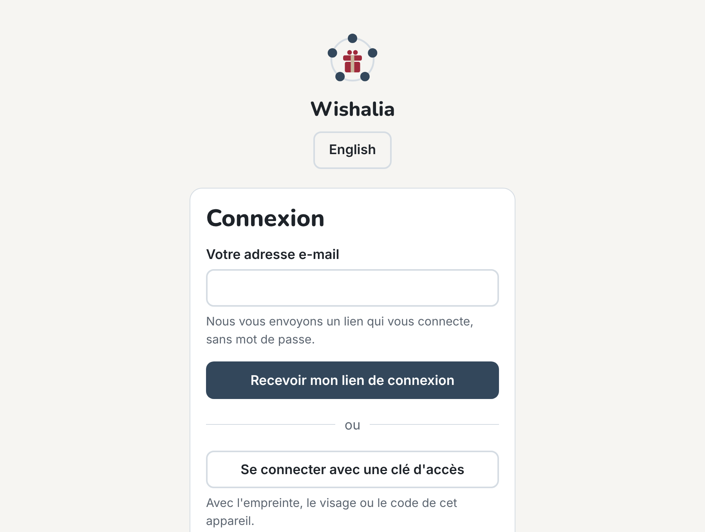
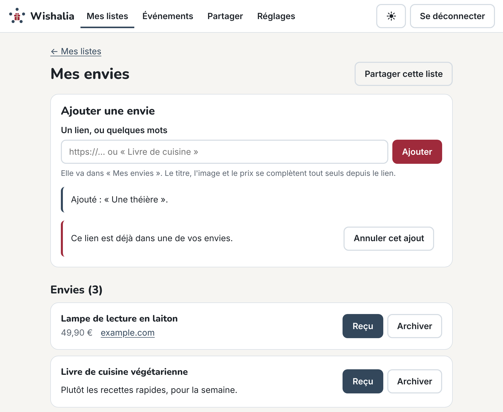
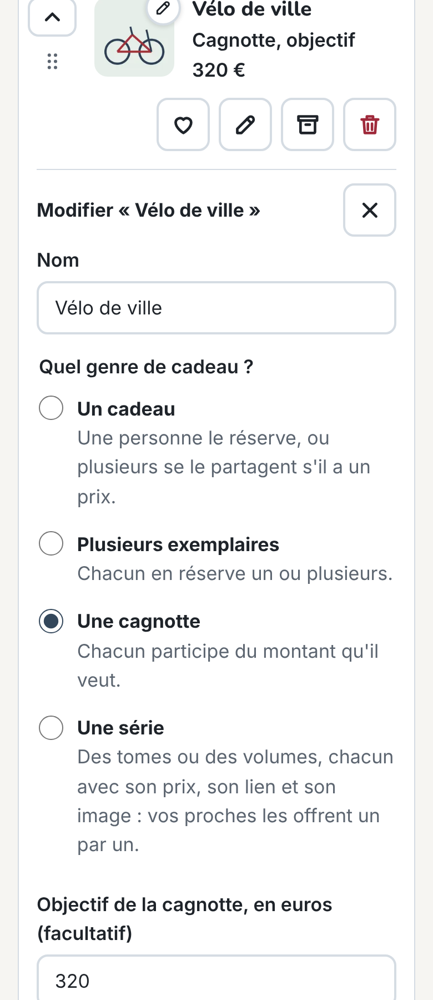
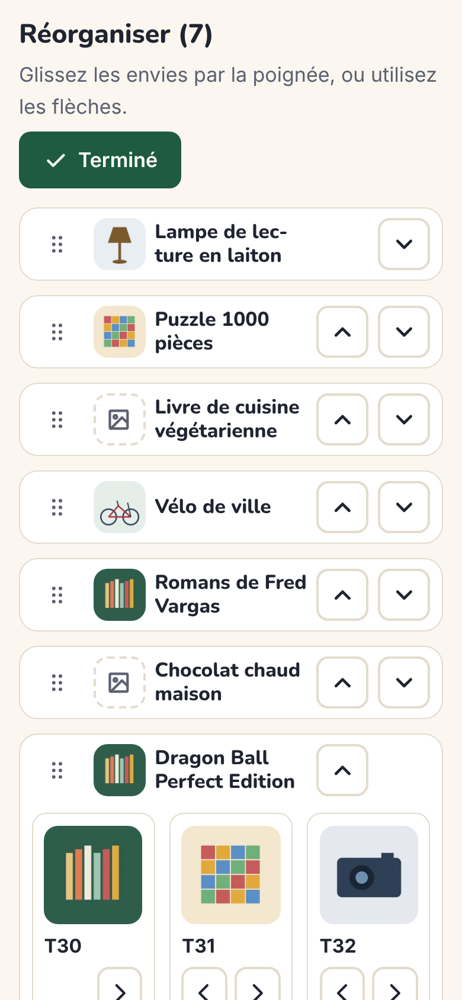
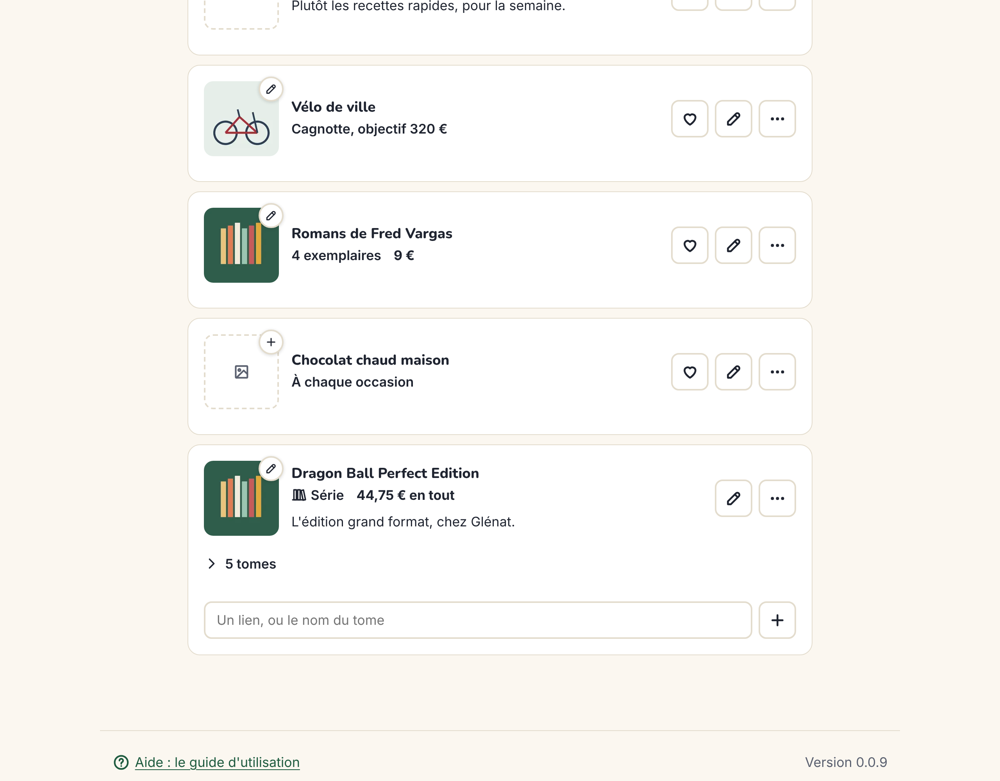
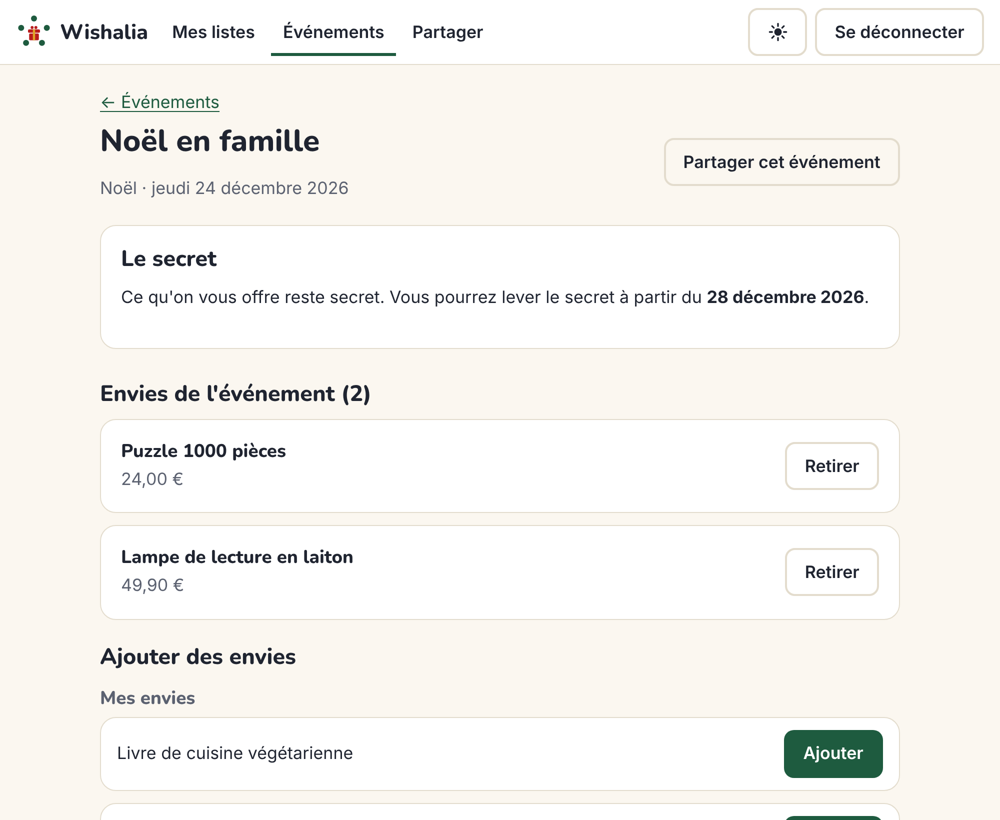
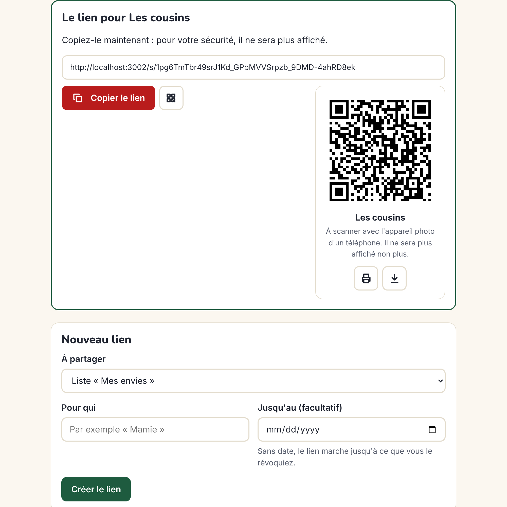
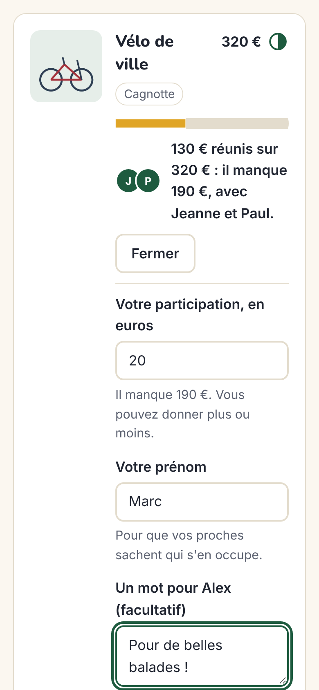

# Guide d'utilisation

Ce guide explique Wishalia à toute la famille, sans jargon : faire sa liste d'envies, la partager,
et offrir un cadeau sans gâcher la surprise. Il est ouvert par le lien « Aide : le guide
d'utilisation », en bas de chaque page. (In English: [User guide](user-guide.md).)

Wishalia a deux côtés :

- **l'application**, où vous faites vos listes (l'adresse que vous a donnée la personne qui
  l'installe, par exemple `app.wishalia.example.com`) ;
- **la vue des proches**, la page qu'ouvrent les personnes à qui vous envoyez un lien : elles y
  voient vos envies et choisissent ce qu'elles offrent.

## La règle d'or : la surprise

Vous ne voyez **jamais** qui offre quoi, ni combien, avant de **lever le secret**, quelques jours
après l'occasion (un anniversaire, Noël…). Vos proches, eux, voient ce qui est déjà pris, pour ne
pas offrir deux fois la même chose.

## Se connecter

Sur la page « Se connecter », trois façons d'entrer, sans mot de passe :

- **une clé d'accès** : le téléphone ou l'ordinateur demande l'empreinte, le visage ou son code ;
- **un lien par e-mail** : tapez votre adresse, ouvrez l'e-mail reçu et touchez le lien ;
- **le bouton de votre fournisseur de connexion**, quand la personne qui installe Wishalia l'a
  prévu.

## Faire sa liste

### Ajouter une envie

Le champ en haut de l'accueil ajoute une envie en un geste : collez un **lien** vers la page d'un
site, ou tapez **quelques mots** (« Un pull bleu, taille M »), puis Entrée. L'envie est là tout de
suite ; avec un lien, Wishalia lit la page et complète le nom, le prix et les images tout seul.

Sur un téléphone, le **code-barres** à côté du champ ouvre l'appareil photo : visez le code-barres
d'un livre, et « Ajouter » le met dans la liste avec son titre. Pour une **série** (les tomes d'une
collection), ajoutez le premier tome comme une envie, puis choisissez le genre « Une série » (voir
plus bas).

Au-delà de quelques envies, la **loupe** en haut de la liste retrouve une envie par son nom ou ses
notes.

### Modifier une envie

Le **crayon** d'une envie l'ouvre sur place : son nom, son prix, son lien, vos notes pour la
famille, son genre. Tout s'enregistre au fil de la saisie, sans bouton « Enregistrer ».

Le genre dit ce que vos proches peuvent faire :

- **Un cadeau** : une personne l'offre, ou plusieurs se le partagent ;
- **Plusieurs exemplaires** : par exemple 3 paires de chaussettes ; les boutons − et + règlent le
  nombre ;
- **Une cagnotte** : chacun donne ce qu'il veut, vers un montant ;
- **Une série** : les tomes d'une collection, offerts un par un (voir plus bas).

### Changer l'image

Le **crayon sur l'image** ouvre « Image de … » : choisissez une image de la page du lien, envoyez
une photo de votre appareil, ou recadrez celle qui s'affiche.

### Ranger les envies

Vos proches voient vos envies dans l'ordre que vous choisissez. Touchez **« Réorganiser »** en haut
de la liste : chaque envie devient une ligne avec sa **poignée** (les six points). Glissez-la, à la
souris ou au doigt, aussi loin que vous voulez vers le haut ou vers le bas, ou utilisez les
**flèches** qui la montent ou la descendent d'une place à chaque appui. « Terminé » revient à la
liste.

### Les séries

Une **série** réunit les tomes d'une collection (livres, BD, mangas) sur une seule carte. Chaque
tome a son prix, son lien, son image, et vos proches les offrent un par un.

- Pour en créer une : le crayon d'une envie, puis le genre « Une série » ; ou le bouton « Ranger des
  envies dans la série » pour y mettre les envies qui en font partie.
- Pour ajouter un tome : le champ en bas de la carte (un lien ou quelques mots). La carte reste
  ouverte et montre le nouveau tome.
- Les tomes s'affichent en **vignettes**, côte à côte ; le chevron les replie sous « 5 tomes ».
  Le crayon d'une vignette modifie le tome, son menu « ⋯ » le sort de la série ou le supprime.
- L'image de la série se choisit parmi **toutes les images de ses tomes**, ou parmi une photo que
  vous envoyez.

### Reçu, archiver, supprimer

Le **cœur** dit qu'une envie a été reçue. Le menu **« ⋯ »** de la carte rassemble le reste : relire
son lien, l'archiver, la supprimer. La **boîte** archive une envie ou une liste : elle quitte
la vue des proches et revient quand vous voulez. La **poubelle** la supprime pour de bon ; vos
proches qui avaient prévu de l'offrir sont prévenus.

## Les occasions

« Événements » réunit vos occasions (un anniversaire, Noël…) et les envies de chacune. Après la date,
« Lever le secret » vous montre enfin qui vous a offert quoi, pour pouvoir remercier.

## Partager sa liste

« Partage » crée un **lien** pour une liste ou un événement, au nom de qui le reçoit (« Mamie »,
« Les cousins »). Envoyez-le par message ou par e-mail. Un lien se retire à tout moment, et il ne
donne jamais accès à vos réglages.

« Envoyer… » ouvre le menu de partage du téléphone (SMS, WhatsApp, e-mail…). Le bouton **QR code**
montre un code à scanner avec l'appareil photo d'un proche, à imprimer ou à enregistrer comme image.

L'**œil** « Aperçu », sur une liste, montre ce que vos proches verront, avec des exemples à la place des vrais
noms.

## Offrir un cadeau (pour les proches)

Ouvrez le lien qu'on vous a envoyé : la liste s'affiche, ce qui reste à offrir en premier. Les
**filtres** au-dessus des envies n'en gardent qu'une partie : « À offrir », une occasion (« Noël »),
« Prix » (les moins chères d'abord) et « Mes cadeaux ». Touchez un filtre à nouveau pour l'enlever.

1. Touchez **« Acheter / Participer »** sous l'envie choisie.
2. Écrivez votre prénom, et, pour un cadeau partagé, le montant que vous donnez ; pour plusieurs
   exemplaires, combien vous en offrez, avec − et +.
3. Confirmez : l'envie est marquée comme prise pour les autres proches, pas pour la personne qui
   reçoit.

Pour une série, chaque tome a son bouton « Offrir », et « Offrir les 3 tomes restants » les achète
tous d'un coup.

« Me retirer » reprend votre participation tant que le secret n'est pas levé. Le bouton « Voir sur
… » ouvre la page du magasin, pour acheter.

## Affichage, langue et application

- Le bouton d'**affichage** (soleil, lune ou écran), en haut à droite, règle le mode clair ou sombre, le thème (Neutre, Noël)
  et la langue (français ou anglais), et la **taille du texte** : A, A+ ou A++, gardée sur
  l'appareil.
- Le **point d'interrogation** ouvre l'aide : ce guide, et les sujets de la page où vous êtes. Un
  petit « ? » à côté d'un réglage l'explique en une phrase.
- Sur un téléphone, Wishalia s'**installe comme une application** depuis le navigateur : voir
  [Installer l'application](install-app.md).
- En bas de chaque page : ce guide, et la **version** de Wishalia, à donner si vous signalez un
  problème.

## Besoin d'aide ?

Demandez à la personne qui a installé Wishalia pour la famille. Un problème ou une idée : ouvrez un
ticket sur [GitHub](https://github.com/Arcanexus/wishalia/issues), en indiquant la version affichée
en bas de page.
