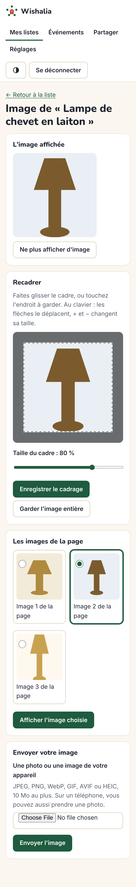
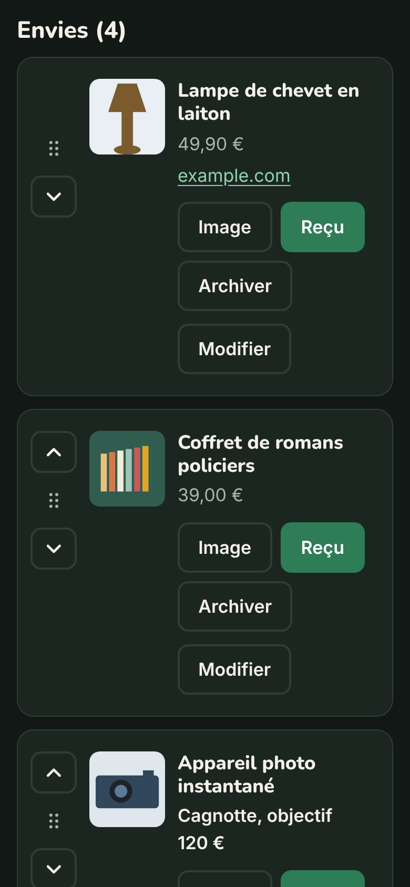

# Images of the items

Each item can show an image: on the owner's lists, in the preview, and on the page the family opens.
The owner does nothing for most of them: when an item is added with a link, the worker takes **up to
four images from the page** and the item shows the first. The owner can then pick another one, send
their own photo, and frame it.



Images are optional: they need a place for the files, **a volume or an S3 bucket**, and imgproxy
(see [Set-up](#set-up)). Without them, Wishalia works the same, with no image.

## The « Image » page

Each item of a list has an **Image** button. Its page has, in this order:

- **The image shown**, as the family sees it, and « Ne plus afficher d'image ».
- **Recadrer**: a square frame over the image (the thumbnails are square). It moves four ways, for
  every hand: drag it, tap where it should be (one tap, no dragging needed, WCAG 2.5.7), the arrow
  keys (Shift for bigger steps, + and − for its size), or the « Taille du cadre » slider. « Garder
  l'image entière » removes the frame. Framing needs JavaScript; everything else on the page works
  without it.
- **Les images de la page**: the images found on the page of the link, and the owner's own, to
  choose from. While the worker is still reading the page, the page says so.
- **Envoyer votre image**: a photo from the phone (or the camera) or a picture from the computer.
  JPEG, PNG, WebP, GIF, AVIF or HEIC, 10 MB at most. A photo over 1.5 MB is made lighter on the
  device before it leaves (2 048 px on its longest side, JPEG): quicker on a weak connection, and the
  browser drops its EXIF data on the way. Sending a new image replaces the previous one sent.

Every change writes an `image_changed` entry to the item's history (owner only).



## The page's images

When the worker reads the page of a link ([Enrichment](enrichment.md)), it also collects the links of
its images, best first: the product's own (`image` of the JSON-LD `Product`), the sharing image
(`og:image`, `twitter:image`, `image_src`), then the photos of the page (``, leaving out logos,
icons, sprites, SVG and anything declared under 120 px). It tries eight links at most and keeps four
images at most. Each one is:

- fetched with **the same guard as the page** (public addresses only, checked after the DNS answer
  and at every redirect, standard ports, 10 seconds), and 10 MB at most;
- read again **from its bytes**: only a real JPEG, PNG, WebP, GIF, AVIF or HEIC is kept, never SVG
  (it can carry scripts) and never what the site's `Content-Type` claims;
- at least 120 px on each side when its size is known, and 50 megapixels at most;
- stored under a random key, on the volume or in the bucket.

The item shows the first one, unless the owner chose their own: a later run (a new link) replaces the
page's images, and keeps the owner's. When the images arrive, an `image_changed` entry is written to
the history. Items that already had a link when images came in are read once more, for their images
only (the owner's title and price stay).

## How the images are served

```
browser ──/img/<signature>/<options>/<source>.webp──▶ web-app / web-public ──▶ imgproxy ──▶ volume or bucket
```

- The API never gives a browser the place of a file. It gives **signed paths** (HMAC-SHA256 with
  `IMGPROXY_KEY` and `IMGPROXY_SALT`) for three sizes: `small` (192 px square), `medium` (480 px
  square), both framed, and `large` (1 200 px, whole, to frame it). A browser cannot ask for another
  file or another size: imgproxy refuses what the API did not sign, and the frontends refuse any path
  that does not look signed before asking imgproxy.
- The two frontends pass imgproxy's answer on under `/img/`, on their own host: the CSP keeps
  `img-src 'self'`, and imgproxy and the files stay inside the cluster. A path names a file that
  never changes, so the browsers keep it for a year.
- imgproxy only reads the image files (`local:///` under the volume, mounted read-only, or
  `s3://<bucket>/`), never a URL, at most 10 MB and 50 megapixels, turns photos the
  right way, and drops their metadata (EXIF, where a photo was taken) from what it sends.
- The images are WebP, which every browser of the last years reads.

The images say nothing about who gave what: the guests get the same signed paths as the owner, and
no image is ever a contribution data.

## Where the files live

| `images.storage`   | What it needs                                                                                                                                                 | Fits                                                     |
| ------------------ | ------------------------------------------------------------------------------------------------------------------------------------------------------------- | -------------------------------------------------------- |
| `volume` (default) | A PersistentVolumeClaim, created by the chart (`images.persistence.size`, `storageClass`) or yours (`images.persistence.existingClaim`). Nothing else to run. | A homelab, one node or a shared file system (NFS, Ceph). |
| `s3`               | An S3-compatible bucket (MinIO, Garage, a cloud bucket), its endpoint and its keys.                                                                           | Several nodes, or a bucket you already back up.          |

On a volume, the API and the worker write the files and imgproxy mounts it read-only, at
`/data/images` in the three pods. A `ReadWriteOnce` volume (most storage classes) can only be
mounted on one node: the chart then keeps the API, the worker and imgproxy on the API's node (a
`podAffinity`, unless you set `affinity` yourself). With a `ReadWriteMany` volume they may run
anywhere. The claim the chart creates is kept on `helm uninstall`: the photos the family sent are not
lost with a release. A file is written beside its place and then renamed, so imgproxy never reads
half of one.

Changing from one to the other does not move the files: the page images come back with the next
enrichment of each item, the photos the owner sent have to be copied over (same keys, `wishes/...`).

## Set-up

| Where              | What                                                                                                                                                                                                                         |
| ------------------ | ---------------------------------------------------------------------------------------------------------------------------------------------------------------------------------------------------------------------------- |
| Chart              | `images.enabled: true`, then `images.persistence.*` for a volume, or `images.storage: s3` and `images.s3.endpoint` (and `region`, `bucket`). The chart deploys imgproxy, internal only. See [Chart values](chart-values.md). |
| `existingSecret`   | `IMGPROXY_KEY`, `IMGPROXY_SALT`: hex, 32 characters or more each (`openssl rand -hex 32`). With S3, also `S3_ACCESS_KEY`, `S3_SECRET_KEY`.                                                                                   |
| The bucket         | Created by the worker when it is missing, if its keys may. Only the API and the worker write in it; imgproxy reads it. Nothing in it is public.                                                                              |
| Without Kubernetes | Set the variables of [Configuration](configuration.md#images) on the API, the worker and the frontends (`IMGPROXY_URL`). `docker compose up` starts MinIO and imgproxy with local keys.                                      |

The API refuses to start when the image settings are only half set, and lists what is missing.
