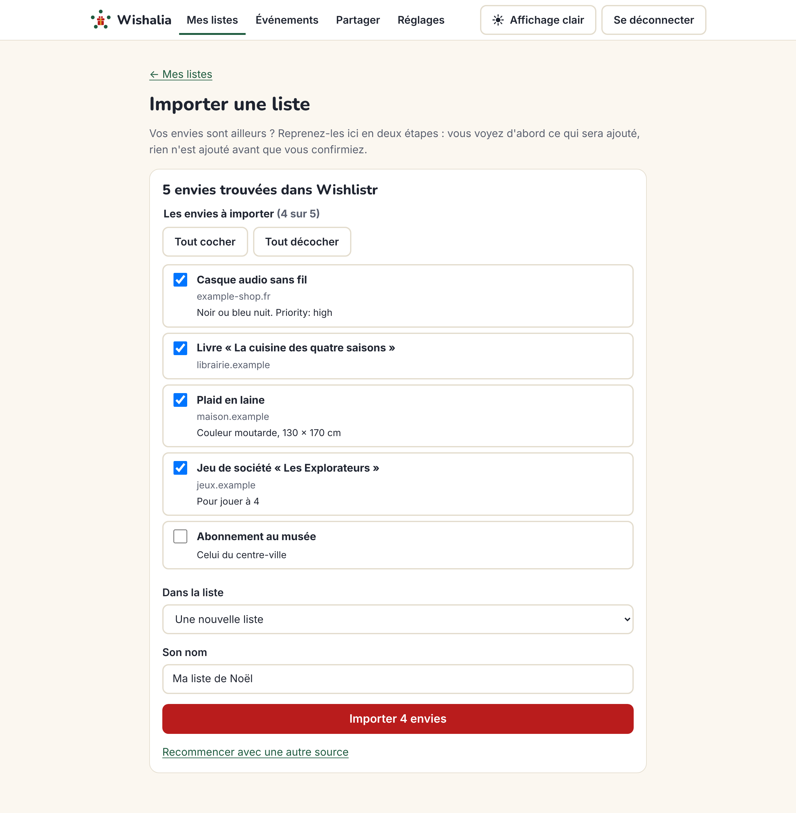

# Importing a list

Wishes kept on another service come into Wishalia in two steps: Wishalia reads the source and shows
what it found, then adds the wishes the person kept, to the list they choose. Nothing is added before
they confirm. The page is « Importer une liste » (`/importer`), linked from the home page under the
lists.



## What each service lets you take away

| Service                                           | What it offers                                                                                       | How to import                                                              |
| ------------------------------------------------- | ---------------------------------------------------------------------------------------------------- | -------------------------------------------------------------------------- |
| **Wishlistr** (wishlistr.com)                     | No export file, but every list has a public page (the address shared with relatives) and an RSS feed | « Une liste Wishlistr »: paste the address, like `wishlistr.com/alex`      |
| **Amazon** (listes d'envies)                      | No export; browser extensions save a list as CSV                                                     | « Un fichier » with that CSV, or « Un texte copié » with the links         |
| **Giftster, Elfster, MyRegistry, Giftlist**       | No documented export file; a share link per list                                                     | « Un texte copié »: copy the list's page (or its links), one wish per line |
| A spreadsheet (Excel, LibreOffice, Google Sheets) | « Enregistrer sous » CSV                                                                             | « Un fichier », with a header row (see below)                              |
| Any service with a JSON export, or a script       | JSON                                                                                                 | « Un fichier »                                                             |
| Notes, an e-mail, a message                       | Text                                                                                                 | « Un texte copié »                                                         |

Wishalia never signs in to another service on someone's behalf and never asks for a password there:
it only reads what the person hands it (a file, a text) or the page their list already shows to
anyone with its address.

## Wishlistr

Paste the address of the list, the one Wishlistr's « Share list » gives (for example
`https://www.wishlistr.com/alex/`). The list must be visible without an account. Wishalia reads that
page once, and takes for each item its title, its comment (as the notes, « Priority: … » included)
and the shop's link. The list's title becomes the name proposed for the new list. Wishlistr has no
price field; the worker completes the price and the image from each link afterwards, like for any
added item ([Completing items from their link](enrichment.md)).

Only `www.wishlistr.com/<name>/` is ever fetched, at an address Wishalia builds itself from what was
pasted: no other site, no redirect followed, 10 seconds and 3 MB at most, 10 reads a minute per
person. Wishlistr's own redirect links (`/dp/…`, closed to robots) are never followed: the shop's
address is already on the page.

## Files: CSV and JSON

A file is 1 MB at most and 500 wishes at most per import (the rest is reported, and can be imported
in a second go).

**CSV**: a header row names the columns; the separator (comma, semicolon or tab) is guessed, quotes
and line breaks in a cell are read as in RFC 4180, and a UTF-8 BOM is ignored. The columns are found
by their names, in French, English, German or Spanish, without case or accents. Other columns are
ignored.

| Field    | Column names understood (examples)                                     |
| -------- | ---------------------------------------------------------------------- |
| Title    | `Titre`, `Nom`, `Title`, `Name`, `Item`, `Product`, `Article`, `Envie` |
| Link     | `Lien`, `URL`, `Link`, `Product URL`, `Adresse`                        |
| Price    | `Prix`, `Price`, `Montant`, `Amount`, `Price when added`               |
| Currency | `Devise`, `Currency`                                                   |
| Quantity | `Quantité`, `Qté`, `Quantity`, `Qty`, `Requested`                      |
| Notes    | `Notes`, `Commentaire`, `Description`, `Comment`, `Détails`            |

A title or a link column is needed; a row with neither is left out and counted. A row with only a
link gets the site's name as its title, until the worker finds the real one.

```csv
Titre;Lien;Prix;Quantité;Commentaire
Livre de cuisine;https://www.example.com/livre;24,90;;Le tome 2
Chaussettes;;8;3;Taille 39-42
```

**JSON**: an array of wishes, or an object with the array under `items` (or `wishes`, `gifts`,
`products`, `envies`) and the list's name under `name` (or `title`, `listName`). Each wish is an
object with the same field names as the CSV columns, or a plain string read like the quick add.
A price may also be `{ "amount": 15, "currency": "EUR" }`.

```json
{
  "name": "Noël de Léa",
  "items": [
    { "title": "Puzzle", "url": "https://www.example.com/puzzle", "price": 15 },
    { "name": "Peluche", "notes": "Un renard", "quantity": 2 },
    "Un livre https://www.example.com/livre"
  ]
}
```

## Pasted text

One wish per line, read like the quick add: a link, a few words, or both. List markers (`-`, `*`,
`•`, `1.`, `2)`) are dropped and empty lines skipped.

## What is kept, and what is not

- **Title** (300 characters at most), **link**, **notes** (4,000 characters), **price** and
  **quantity**. Text is kept as text: no HTML, no control or direction characters.
- Links go through the same cleaning as every link in Wishalia: `http(s)` only, tracking parameters
  removed. A link that is not one (`javascript:`…) is dropped, the wish kept.
- Prices are read in euros only (« 12,50 € », « 1 299,00 », `12.5`), in cents. A price in another
  currency (`$`, `£`, a `Currency` column other than `EUR`) is left out rather than converted.
- A quantity of 2 or more makes a « plusieurs exemplaires » item (1,000 at most).
- A link already in an open item of the chosen list is not added twice; the list page says how many.
- The images, reservations and anything relatives did on the other service are not imported:
  reservations elsewhere would be contributions, which only the family may see.

The wishes are added after the list's current ones, in the order of the source. Each one writes its
`created` entry in its history, marked `importedFrom` with the source, and the ones with a link are
queued for the worker.

## For developers

The importers are pure functions of `@wishalia/domain` (`packages/domain/src/imports.ts`): each one
turns its source into raw rows (`RawWish`), which one function, `normalizeWish`, cleans. Adding a
service means writing its reader and adding it to `IMPORT_SOURCES`; the API, the checks and the page
stay the same. The API routes are in [Management API](api.md#imports).
