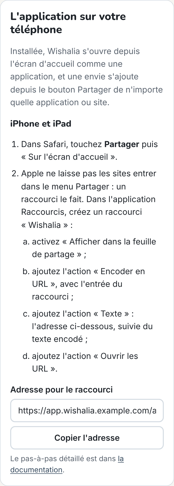
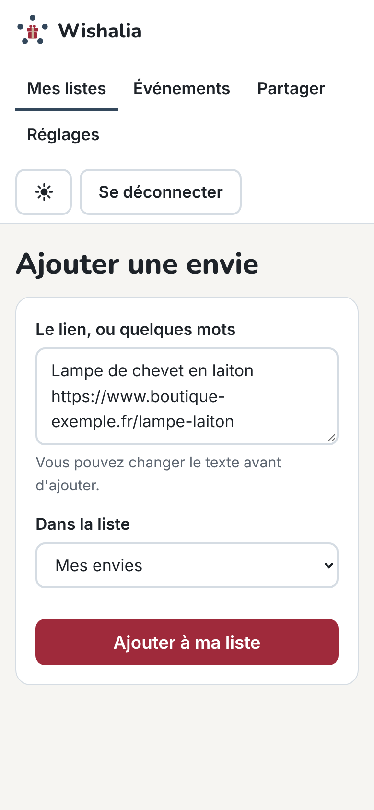

# Install the app

The management app installs on a phone, a tablet or a computer like any other app (it is a
Progressive Web App): an icon on the home screen, a window without the browser's bars, and
**Wishalia in the system's share menu**, so that a wish is added from a shop's site or app in two
taps. « Réglages » shows the steps for the device in hand, and an « Installer Wishalia » button where
the browser offers one (Chrome and Edge on Android, Windows, ChromeOS and Linux).

## Android

1. In Chrome, open the app, then the menu ⋮ and « Installer l'application » (or « Ajouter à l'écran
   d'accueil »). The « Installer Wishalia » button in « Réglages » does the same.
2. From any site or app (a shop, Chrome, YouTube...), tap **Partager**, then **Wishalia**.
3. The « Ajouter une envie » page opens with the link and its title already in the field. Change
   the words or the list if you like, then tap « Ajouter à ma liste ».

The share menu sends the shared title, text and link to `/ajouter?title=…&text=…&url=…` (a Web
Share Target in the manifest). Apps fill these in their own way: Chrome puts the page title in the
title and the link in the text, a shop puts « Product name https://… » in the text. The page keeps
the link (cleaned of its tracking parameters) and the longer of the words, so that a title such as
« Amazon.fr » does not win over the product name. The worker then completes the title, the price and
the image from the link, as for any quick add ([Enrichment](enrichment.md)).

Long-pressing the installed icon also offers « Ajouter une envie » and « Mes événements ».

## iPhone and iPad

1. In Safari, open the app, tap **Partager** (the square with an arrow), then « Sur l'écran
   d'accueil ».
2. Apple does not let a web app into the share menu, so a **Shortcut** does it. In the Shortcuts
   app:
   1. Tap **+** to create a shortcut, and name it « Wishalia ».
   2. Tap ⓘ (details) and turn on « Afficher dans la feuille de partage ». In « Types reçus », keep
      « URL » and « Texte ».
   3. Add the action **Encoder en URL**, with « Entrée du raccourci » as what it encodes.
   4. Add the action **Texte**, and type the address that « Réglages » shows under « Adresse pour le
      raccourci » (« Copier l'adresse » copies it), for instance
      `https://app.wishalia.example.com/ajouter?text=`, followed by the variable « Texte encodé en
      URL ».
   5. Add the action **Ouvrir les URL**, with that text.
3. From Safari or a shop's app, tap **Partager**, then **Wishalia**: the « Ajouter une envie » page
   opens with the link in the field, and « Ajouter à ma liste » adds it.

The shortcut opens Safari. If the app is not signed in there, the sign-in page comes first, and
brings back the shared link once signed in.

### Without opening anything

When the [REST API v1](rest-api.md) is on (`hosts.api`), a shortcut can add the wish in the
background, without opening a page:

1. In « Réglages », create a token named « Raccourci iPhone » (not read-only), and copy it.
2. In the shortcut, replace the actions of step 2 with **Obtenir le contenu de l'URL**:
   - URL: `https://api.wishalia.example.com/v1/items`;
   - Méthode: `POST`;
   - En-têtes: `Authorization` = `Bearer wsh_…` (the token);
   - Corps de requête: JSON, with a text field `input` = « Entrée du raccourci ».
3. Add **Afficher la notification** « Ajouté à Wishalia » to know it worked.

The token stays in the shortcut, on the phone: give it a lifetime, and revoke it in « Réglages » if
the phone is lost. The wish goes to the first list.

## Computer

In Chrome or Edge, the install icon sits at the right of the address bar (or « Installer
Wishalia » in « Réglages »). In Safari on a Mac, choose « Fichier », then « Ajouter au Dock ».

## What is installed

- The manifest, `/manifest.webmanifest`, gives the name (`APP_NAME`), the icons, the colours and the
  share target. It is public: browsers fetch it without cookies, and it holds nothing about anyone.
- The icons live in `apps/web-app/static/icons/`: 192 and 512 px, a maskable 512 px one whose logo
  stays inside the safe zone, and a 180 px `apple-touch-icon.png`. They are drawn from the logo on
  the neutral background ([Branding](branding.md)).
- The colour of the phone's status bar follows the person's theme and mode (`theme-color`).
- A service worker (`apps/web-app/src/service-worker/`) keeps the app's code (whose file names
  change with their content) and the icons, so that the installed app starts fast. It **never keeps
  a page, an API answer or an image**: lists are private and change all the time. Without a
  network, a page shows « Pas de connexion » and a « Réessayer » button. A new version replaces the
  old cache as soon as it is installed.
