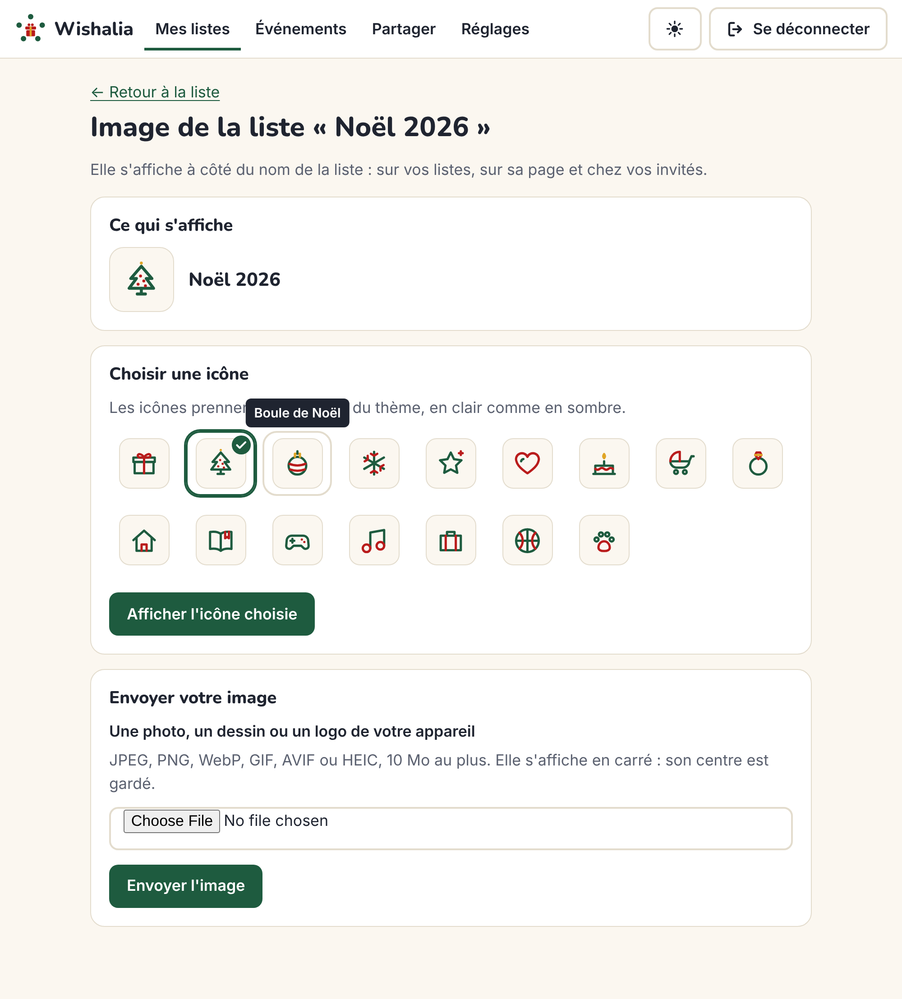
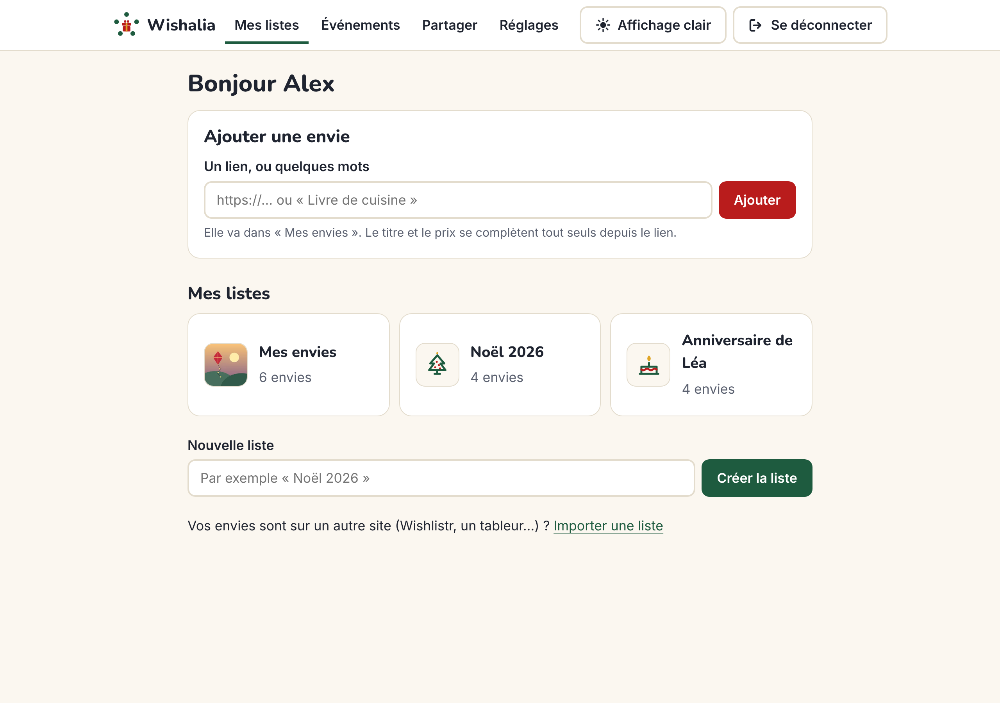
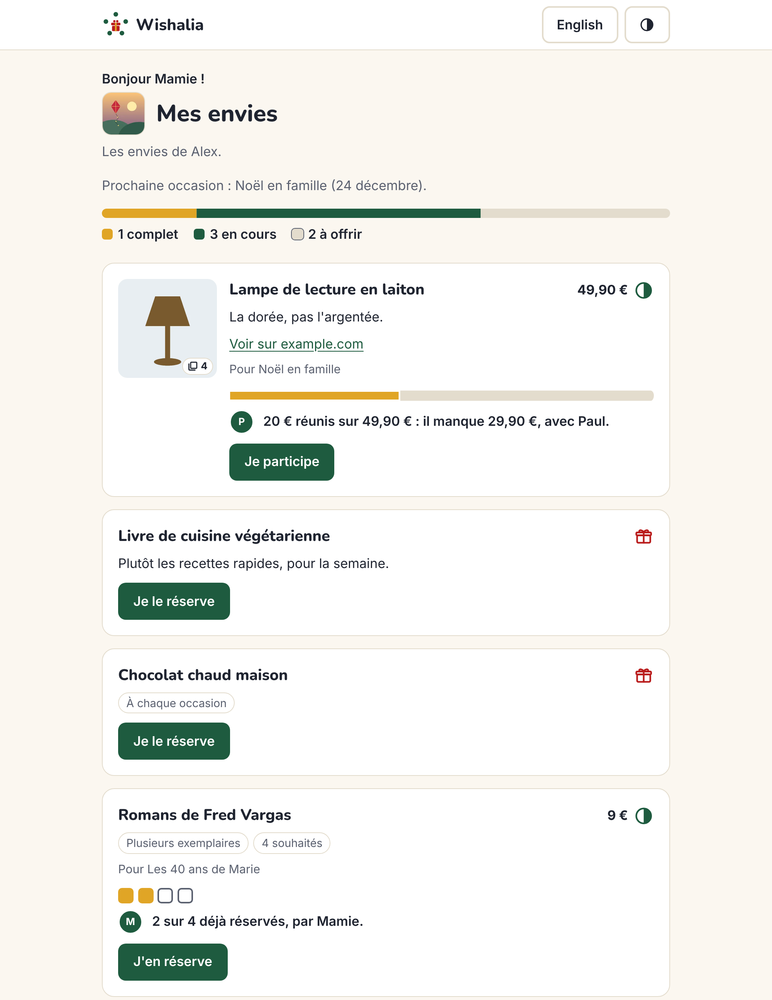

# Pictures of the lists

Each list shows a picture next to its name: **one of sixteen icons** drawn by Wishalia, or **an image
the owner sends** (a photo, a drawing, a club's logo). It shows on the owner's lists, at the top of
the list's page, in the preview, on the page the family opens and in the public host's search. Every
picture is the same rounded square, so the names line up whatever each list shows.

## Choosing it

On a list's page, the picture next to its title is a link (a small pencil on its corner, « Changer
l'image de la liste » in a tip on hover and on keyboard focus). The list's settings have the same
link, under « Image de la liste ». Its page has, in this order:

- **Ce qui s'affiche**: the picture as everyone sees it, next to the list's name.
- **Choisir une icône**: the sixteen icons, each with its name in a tip on hover and on keyboard
  focus (Échap hides it) and read by screen readers. The one shown is ticked; « Afficher l'icône
  choisie » saves the choice. Choosing an icon removes the image the owner had sent.
- **Envoyer votre image**: a photo from the phone (or the camera) or a picture from the computer.
  JPEG, PNG, WebP, GIF, AVIF or HEIC, 10 MB at most, made lighter on the device first as the items'
  photos are ([Images](images.md)). It shows as a square, its centre kept. Sending a new image
  replaces the previous one. « Retirer votre image » erases it for good (the file too), and the
  chosen icon shows again.

A list without a choice shows the gift. Servers without images (no volume or bucket) offer the
icons only.

## The icons

| Icon        | For                    | Icon     | For              |
| ----------- | ---------------------- | -------- | ---------------- |
| `gift`      | Cadeau (the default)   | `ring`   | Mariage, Wedding |
| `tree`      | Sapin, Christmas tree  | `house`  | Maison, Home     |
| `bauble`    | Boule de Noël, Bauble  | `book`   | Livres, Books    |
| `snowflake` | Flocon, Snowflake      | `game`   | Jeux, Games      |
| `star`      | Étoile, Star           | `music`  | Musique, Music   |
| `heart`     | Cœur, Heart            | `travel` | Voyage, Travel   |
| `cake`      | Anniversaire, Birthday | `sport`  | Sport            |
| `baby`      | Naissance, Birth       | `paw`    | Animaux, Pets    |

They are drawn as the logo is coloured ([Branding](branding.md)): their lines in the colour of the
logo's heads, a detail in the gift's red and, here and there, the ribbon's gold. Each theme
(neutral or Christmas) and each mode (light or dark) has its three colours, so the icons follow the
page without a variant of their own, and a list that forces a theme shows its icon in that theme.

## For the family

The page of a share link shows the list's picture next to its title, and the home page of the public
host shows it next to each public list found. An event's page has no list picture: it gathers the
items of several lists. The picture is decorative for screen readers (the name next to it says what
the list is).

## Safety

The owner's images go through the same checks as the items' ([Security](security.md)): the API
reads what a file is from its first bytes, never from its name or the browser's word, accepts JPEG,
PNG, WebP, GIF, AVIF and HEIC only (never SVG, which can carry a script), 10 MB and 50 megapixels at
most, and stores it under `lists/<list id>/`. The screens only ever get signed thumbnail paths
(`/img/...`, 192 and 480 px squares, re-encoded to WebP by imgproxy): never where a file is, and the
pages refuse any picture that is not such a path. Deleting the list erases its image too, and the
worker's cleanup removes any file under `lists/` that no list names any more
([Images](images.md#unused-files)).

## API

| Route                                | Does                                                                              |
| ------------------------------------ | --------------------------------------------------------------------------------- |
| `PATCH /manage/lists/:id` `{ icon }` | One of the icons above, or `null` for the default one; removes the owner's image. |
| `PUT /manage/lists/:id/image`        | The image itself as the body (`image/*` or `application/octet-stream`).           |
| `DELETE /manage/lists/:id/image`     | Removes the owner's image: the icon shows again. `404 no_image` without one.      |

Every list in `/manage` gives `icon` (null: the default) and `image` (signed paths, or null). The REST
API v1 has the same routes ([REST API](rest-api.md)). The list's picture says nothing about a gift: no
history entry.
