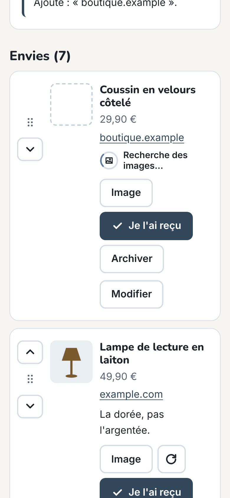

# Live updates

While Wishalia completes an item from its link ([Completing items from their link](enrichment.md)),
the pages that show it follow each step **by themselves**: nobody has to reload the page.

| Step                    | Icon (and its words)                                              | What changed on the page                                       |
| ----------------------- | ----------------------------------------------------------------- | -------------------------------------------------------------- |
| Reading the link        | a chain link in a turning ring, « Lecture du lien… »              | the item shows the site's name                                 |
| Its images on their way | a picture in a turning ring, « Recherche des images… »            | the real title and price are already there                     |
| Done                    | the icon goes                                                     | the first image of the page shows (unless the owner chose one) |
| Link unreadable         | a warning sign, « Lien illisible », with what to do next under it | the item stays as it was                                       |

The longer explanation of a step shows on hover (and a screen reader reads it). The ring stays still
when the device asks for less motion.



The pages that follow along:

- a **list page** of the management app (each new item, « Recharger », « Recharger les liens »);
- the **image page** of an item, where the page's images show up as soon as they are fetched;
- the **guests' page** (a share link or a public list's open link): an item being completed says
  « Mise à jour depuis le lien… », and its title, price and image appear without a reload.

## For a screen reader

Each change is said once, politely, without moving the focus (a `role="status"` region): « « Lampe
en laiton » : titre et prix trouvés. », then « image ajoutée », then « est à jour », or « le lien n'a
pas pu être lu ». The guests hear only « « Lampe en laiton » est à jour. ».

## How it works

The worker writes each step as soon as it knows it: first the title and the price (the item is
then at the step `images`), then its images, then `done`. While at least one item of the page is
on its way, the page asks its own server a question of a few bytes, `GET /listes/:id/suivi` in the
management app or `GET /s/:token/suivi` on the guests' host, that answers:

```json
{ "version": "0kZ0bE3r1pEr6hI6Wm6p3Q", "live": 1 }
```

`version` is a fingerprint of the items as shown (their last change, place, status, image and step);
`live` counts the items still on their way. The page loads its data again **only when the version
moves**, and once nothing is left on its way. It asks every 2 seconds for 2 minutes, then every 10
seconds, and stops after 10 minutes (the worker has given up by then).

Why this and not a connection held open (Server-Sent Events, WebSocket), against the three
priorities:

- **Security**: plain requests on the page's own origin, with its cookies, behind the same checks as
  every other call: nothing new to open in the ingress, the CSP or the API. The fingerprint is made
  from the items' own columns only, so **a contribution never moves it**: the owner cannot learn
  from it that someone gave (anti-spoil). The guests' answer goes through the share link's guard
  (unknown, revoked or expired: the same `404`).
- **Accessibility**: the page changes in place, the focus stays where it is, each step is said once.
  A reload never happens under a wish being edited, a gift being written or an item being dragged:
  it waits until the focus leaves the form.
- **Performance**: one small indexed query per question, no connection kept per open tab, nothing at
  all when no item is on its way or when the tab is hidden (it asks again as soon as it is shown).

The API routes behind it are `GET /manage/lists/:id/live` ([Management API](api.md)) and
`GET /public/live` ([Public view API](public-api.md)). Nothing to configure: no setting, no new port.
