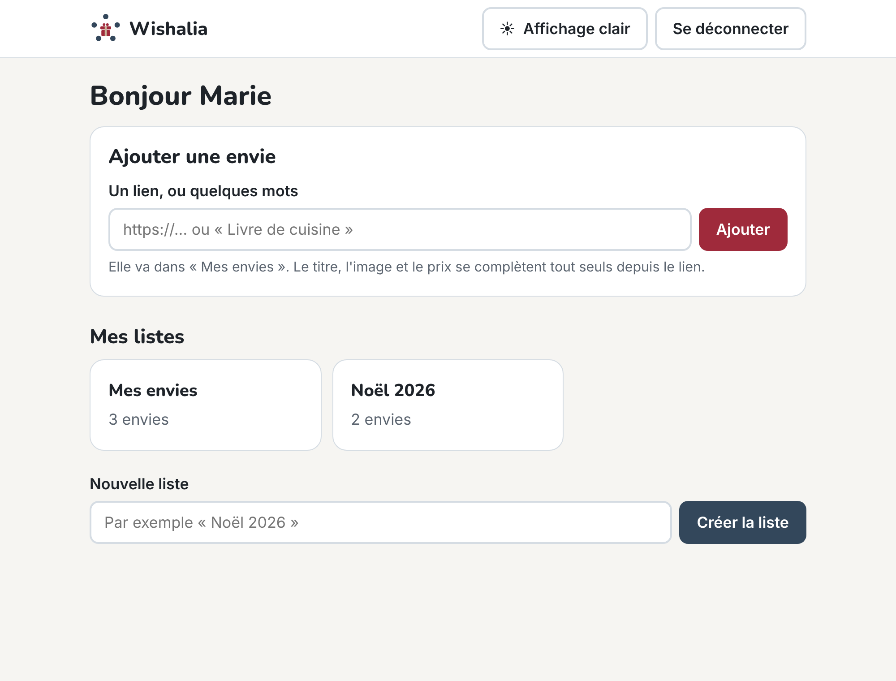
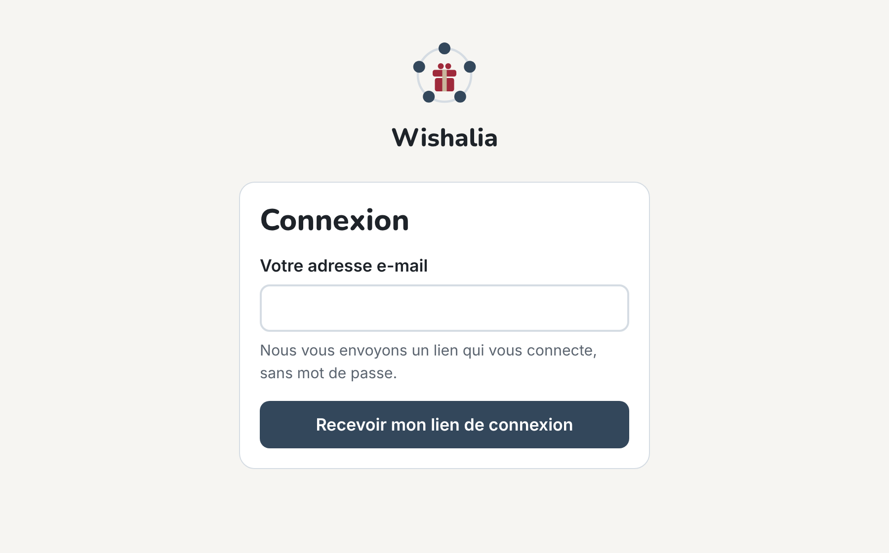
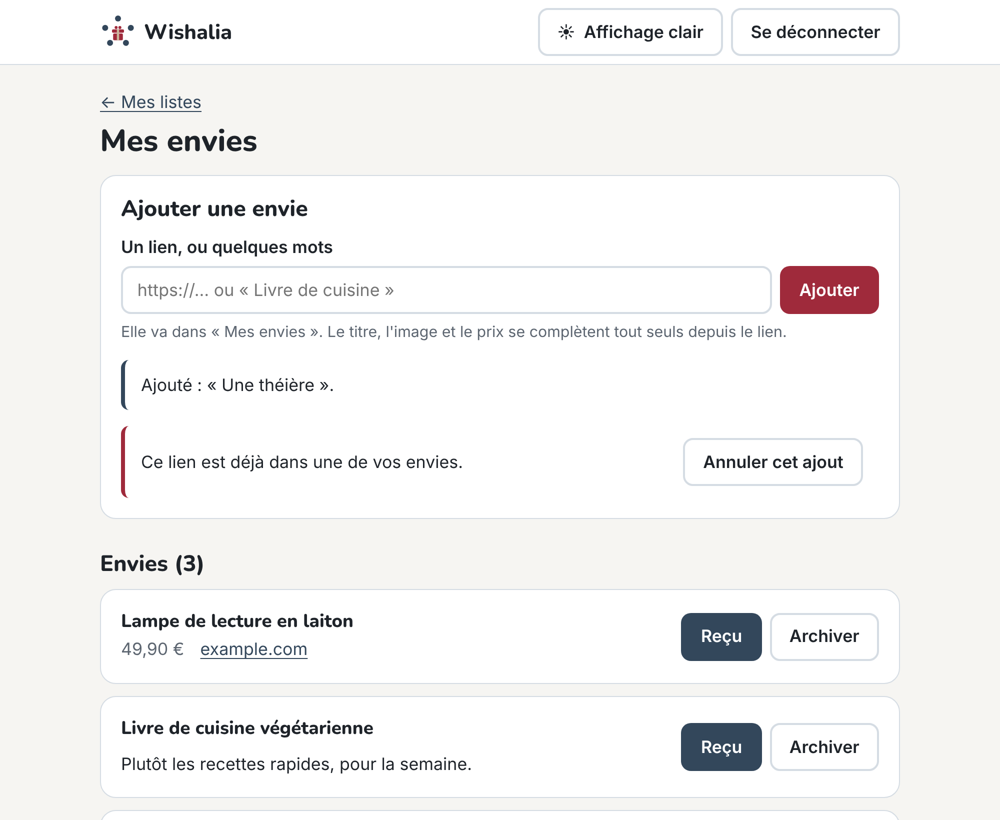
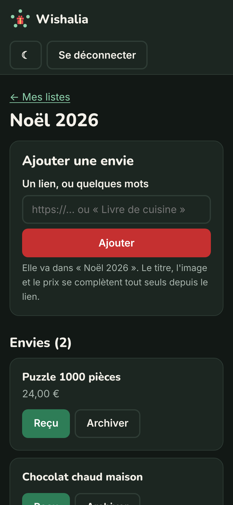

# Management app

The management app (`hosts.app`) is where the owner of the lists works: signing in, their lists,
the quick add. It speaks French and says « vous ». It calls the [Management API](api.md) server side
only: the browser never reaches the API.

## Signing in

`/connexion` offers two ways in, both without a password:

- **A link by e-mail** (magic link): the person types their address and receives a link that signs
  them in, valid a few minutes. It needs `MAIL_FROM` and `SMTP_URL` (see
  [Configuration](configuration.md)).
- **Single sign-on**, when `OIDC_ISSUER` is set: a « Se connecter avec … » button, named by
  `auth.oidc.name`. See [Authentication](authentication.md).

A page opened without a session leads to `/connexion`, then back to that page once signed in (only
a path of the app: never another site). « Se déconnecter » ends the session on the API.

## Lists and the quick add

The home page greets the person, then offers the **quick add**: one field for a link or a few words.
The item shows at once and the field empties for the next one; the worker completes the title, the
image and the price from the link later. From the home page the item goes into the first list (« Mes
envies », created by the very first add), from a list page into that list.

When the link is already in one of the person's open items, the app says so and offers to undo the
add, rather than asking before it.

A list page shows its items, newest first, with their price and the site of their link. Each item
can be marked **received** or **archived**; received and archived items wait under « Reçues et
archivées », where they can be put back in the list. Every change lands in the item's history.

## Themes and accessibility

- The header button switches between the device's mode, light and dark. The choice is kept on the
  device for a year (`wishalia.mode` cookie) and applied by the server, so the page never flashes in
  the wrong colours. A theme forced by a list (`theme` of the list) colours its page, in each
  person's mode. See [Branding](branding.md).
- Every page passes axe (WCAG 2.2 AA) in light and dark, on a phone and a computer: contrast of
  4.5:1 or more, 48 px touch targets, visible focus, a « Aller au contenu » skip link, labels on
  every field and spoken feedback after each action.
- Forms work without JavaScript; with it, they answer without reloading the page.

Coming next: events, share links, settings (theme and mode stored with the account, passkeys,
API tokens).
