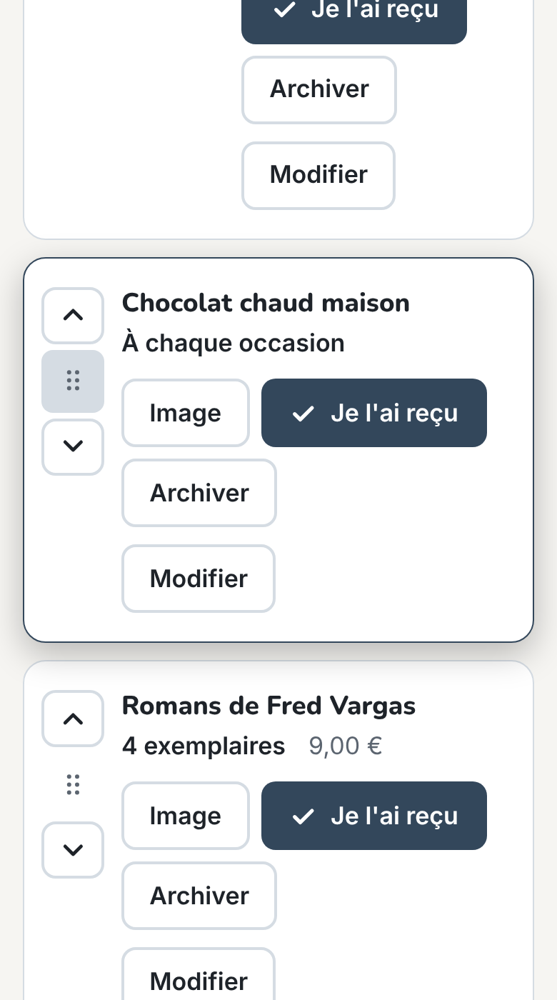
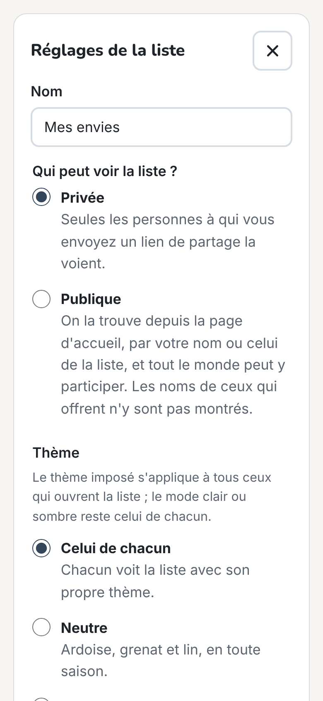
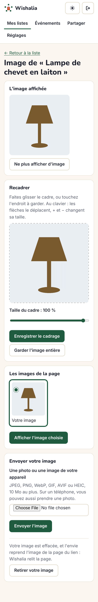

# Management app

The management app (`hosts.app`) is where the owner of the lists works: signing in, their lists,
the quick add, their events and the links they share. It speaks French and says « vous ». It calls the [Management API](api.md) server side
only: the browser never reaches the API.

## Signing in

`/connexion` offers three ways in, all without a password:

- **A passkey**: « Se connecter avec une clé d'accès », and the passkeys of the device are also
  offered in the e-mail field's suggestions. The phone or computer asks for the fingerprint, the face
  or its code; nobody types an address. The button shows only where the browser can use passkeys.
- **A link by e-mail** (magic link): the person types their address and receives a link that signs
  them in, valid a few minutes. It needs `MAIL_FROM` and `SMTP_URL` (see
  [Configuration](configuration.md)).
- **Single sign-on**, when `OIDC_ISSUER` is set: a « Se connecter avec … » button, named by
  `auth.oidc.name`. See [Authentication](authentication.md).

A page opened without a session leads to `/connexion`, then back to that page once signed in (only
a path of the app: never another site). « Se déconnecter » ends the session on the API.

## Lists and the quick add

The home page greets the person, then offers the **quick add**: one field for a link or a few words.
The item shows at once and the field empties for the next one; the worker completes the title and the
price from the link later ([Completing items from their link](enrichment.md)). From the home page the item goes into the first list (« Mes
envies », created by the very first add), from a list page into that list.

When the link is already in one of the person's open items, the app says so and offers to undo the
add, rather than asking before it.

Installed on a phone, the app is also in the system's **share menu**: « Partager », then
« Wishalia », opens « Ajouter une envie » (`/ajouter`) with the shared link and its title in the
field, a choice of list, and one « Ajouter à ma liste » button. The page never adds on its own: the
person sees what will be added and confirms with one tap. On iPhone, a Shortcut does the same. See
[Install the app](install-app.md).

Wishes kept on another service come in with « Importer une liste » (`/importer`, linked under the
lists): a Wishlistr list from its address, a CSV or JSON file (an export, a spreadsheet), or a text
pasted with one wish per line. The page shows what it found, every wish ticked, and the person
unticks what they leave out, then picks a list (a new one, named after the source's list, or one of
theirs) and confirms. The list page then says how many came in. See [Importing a list](import.md).

A list page shows its items, newest first, with what kind of gift they are, their price and the site
of their link. Each item can be marked **received** or **archived**; received and archived items wait under « Reçues et
archivées », where they can be put back in the list. Every change lands in the item's history.

The open items can be put in any order, the one relatives see them in. Each card has a handle to
drag with a mouse or a finger, and two arrows, « Monter » and « Descendre », that move the item one
place in a single tap or from the keyboard (they also work without JavaScript). The new place shows
at once and a screen reader hears it (« « Lampe » est maintenant en position 2 sur 5. »); the
keyboard stays on the moved item. When the list changed on another device meanwhile, nothing moves
and the page says so, with the current order.

### The preview

« Aperçu », next to the list's title, shows the list as the owner's relatives see it through a share
link: the same cards, drawings and words, the list's theme, what is still to give first. The gifts
on it are **made up** for the preview (« Camille (exemple) », « Hugo (exemple) », someone anonymous),
and the page says so: they are built from the items alone, and the page never asks the API for a
history or a contribution, so the preview can give nothing away. The relatives' buttons to give are
left out; the page says they have one under each item.

### A list's settings

« Réglages de la liste », folded under the list's title, holds:

- its **name**;
- **who can see it**: « Privée » (the default), seen only by the people you send a share link to,
  or « Publique », found from the [home page](public-view.md#the-home-page) by your name or the
  list's, where anyone may take part. A public list gets its own address, shown under the choice to
  copy; turning it private again cuts that address at once, and leaves the share links as they are.
  On a public list, guests never see who else gives;
- its **theme**: « Celui de chacun » (everyone sees their own), « Neutre » or « Noël », forced on
  everyone who opens the list, in the app and through its share links; the light or dark mode
  stays each person's own. A new theme reloads the page, since the server draws it;
- **the gifts made without an event**: when their secret lifts, « Quand je marque l'envie reçue »
  (each item's secret lifts once it is received, the default) or « Quand je le décide » (the whole
  list at once). The choice is frozen once the secret is lifted;
- in « Quand je le décide » mode, « Lever le secret de la liste », behind a box to tick: final;
- « Archiver la liste », behind a box to tick: the list leaves the lists, and its share links show
  nothing any more. The app goes back to the lists and says so.

### Editing an item

« Modifier » opens the item in place, under its card: its name, what kind of gift it is, its price,
its list, its link and notes for the family. The kind is a choice of three, each with a line that
says what it means:

- **Un cadeau**: one person reserves it; « À chaque occasion » makes it a gift that can be given
  again at every event (it is then never marked received);
- **Plusieurs exemplaires**: how many are wanted, from 1 to 1,000; each guest reserves one or more;
- **Une cagnotte**: a target in euros, optional; each guest chips in what they want, past the target
  if they like.

Only the fields of the kind chosen show, by CSS, so the form works the same without JavaScript.
Amounts are typed as the person writes them (« 24 », « 12,50 »). A link is cleaned like in the quick
add, and anything that is not an `http(s)` address is refused. When something is wrong, the form
stays open with what was typed and says what to fix. Moving an item to another list takes it off
the page, and the page says so. The API writes the history: `updated`, `price_changed`, `moved`.

## Images

Each item has an **Image** button. Its page shows the image the family sees, lets the owner frame it
in a square (drag, tap, arrow keys or a slider), choose another of the images found on the page of
the link, or send their own photo, up to 10 MB. See [Images](images.md) for the details.

## Events

« Événements » (`/evenements`) lists the person's events, upcoming first, then past ones, the most
recent first. A past event whose secret can be lifted says so. An event has a name, a type
(birthday, Christmas, other), a date and a delay before its secret can be lifted (3 days by
default). A Christmas event is shown in the Christmas theme, unless the person chose another one.

An event's page shows:

- **The secret**: when it can be lifted (the end of the event day plus the delay). From then on, a
  « Lever le secret » button, behind a checkbox that confirms the choice, which is final.
- **The event's items**, which can be removed, and below them the open items of every list, to add
  in one tap. An item stays in its list: the event only selects it.
- **Its settings**, folded away. Once the secret is lifted, the date and the delay no longer change.

Once the secret is lifted, each item shows who gave what for this event: the amount of each
contribution, or the reservation, under the name the guest gave (« Quelqu'un (anonyme) » when they
chose to stay anonymous), with the word they left for the owner, if any. Before, the API gives
nothing of it: the page cannot show what the owner must not see.

The gifts made without an event show the same way on the list's page, under each item, once their
secret lifts: when the item is marked received, or when the list's secret is lifted in « Quand je le
décide » mode.

## Sharing

« Partager » (`/partage`) makes one link per guest or per group, « Mamie », « Les cousins », for a
list or an event. A list page and an event page lead there with that one already chosen. A link may
end on a chosen day; without one, it works until it is revoked.

The link's address is shown **once**, right after it is made, with « Copier le lien » (and « Envoyer…
» where the device can share): only its hash is kept, so it can never be shown again. Making a link
also marks the device as the owner's (`__Secure-wishalia.owner_device`), so that the public view
recognises them and spoils nothing, even without a session.

The active links list who each one is for, what it shares and until when. « Révoquer » asks once
more, then the guest's link answers like an unknown one, for good. Revoked and expired links wait
folded at the bottom.

## Settings

« Réglages » (`/reglages`) holds what follows the person on every device, stored with their
account (`PATCH /manage/me`):

- the first name or nickname their family sees;
- the **theme**: `Automatique` (Christmas in December and for Christmas lists, neutral otherwise),
  `Neutre` or `Noël`;
- **light or dark**: as the device, light or dark. The header button changes the same setting.

The device keeps a copy in its cookies (`wishalia.theme`, `wishalia.mode`), so that the sign-in page
looks the same before the person signs in again.

The **passkeys** (« Clés d'accès ») are listed with their name, the day they were added and whether
the phone or computer's password manager syncs them on all its devices. « Ajouter une clé d'accès »
creates one on this device, under the name typed or one guessed from the device (« iPhone »,
« Mac »...); each can be renamed or deleted. Adding a passkey needs a sign-in of less than a day: an
older session is asked to sign in again, and comes back to the settings. A device that already holds
a passkey of the account is told so. Passkeys need JavaScript; without it, or in a browser without
them, the page says so and the link by e-mail remains.

« L'application sur votre téléphone » shows how to install the app on the device in hand (Android,
iPhone and iPad, computer; every set of steps without JavaScript), an « Installer Wishalia » button
where the browser offers one, and the address an iPhone Shortcut opens, with « Copier l'adresse ».
See [Install the app](install-app.md).

When the REST API v1 is on (`hosts.api`), the page also manages the **API tokens**: a name, a
lifetime of 1 to 365 days (90 by default) and an optional read-only mode. A new token is shown once,
with « Copier le jeton »; the list shows each one's first characters, its end and when it was last
used, and « Révoquer » ends it for good. See [REST API v1](rest-api.md).

## Themes and accessibility

- The header button switches between the device's mode, light and dark. The choice is kept with the
  account and on the device (`wishalia.mode` cookie), and applied by the server, so the page never
  flashes in the wrong colours. A theme forced by a list (`theme` of the list) colours its page, in each
  person's mode. See [Branding](branding.md).
- Every page passes axe (WCAG 2.2 AA) in light and dark, on a phone and a computer: contrast of
  4.5:1 or more, 48 px touch targets, visible focus, a « Aller au contenu » skip link, labels on
  every field and spoken feedback after each action.
- Forms work without JavaScript; with it, they answer without reloading the page.

The guests' screens are in [Public view](public-view.md).
