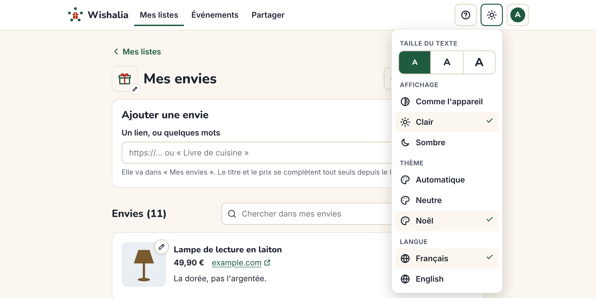
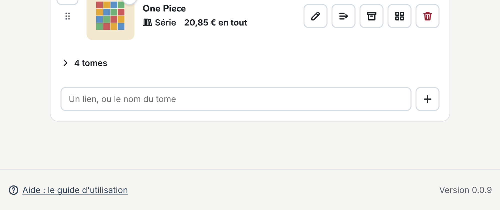
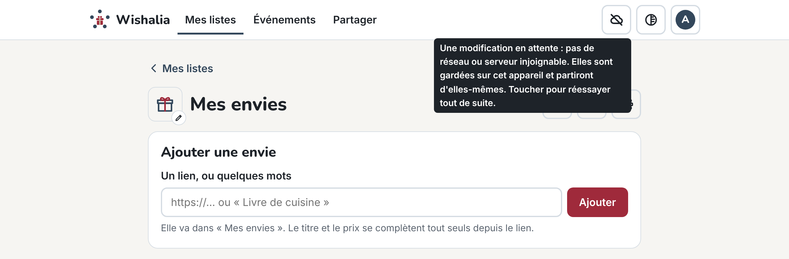
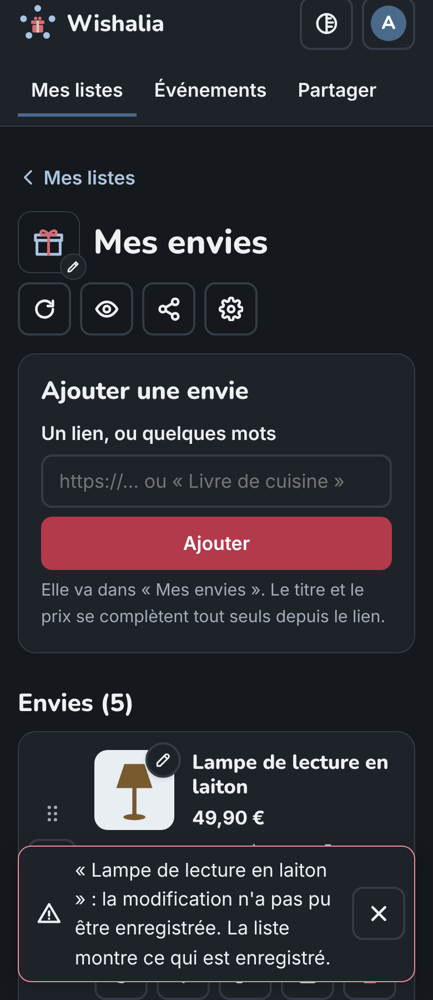
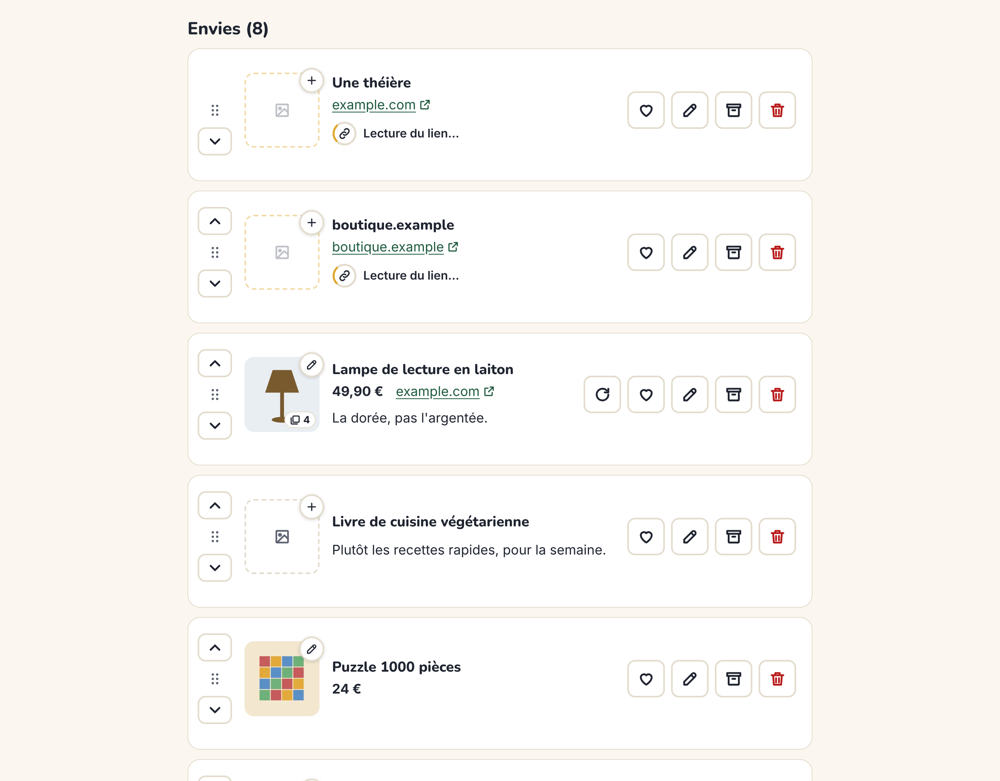
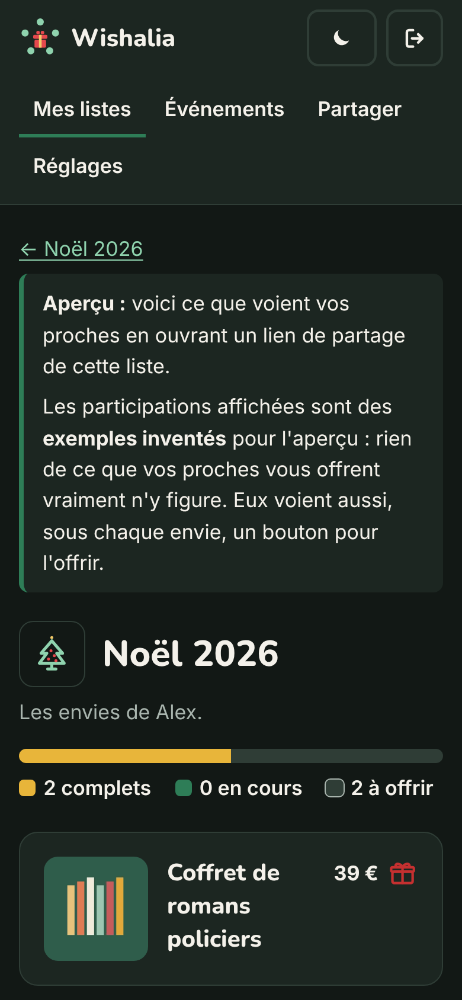
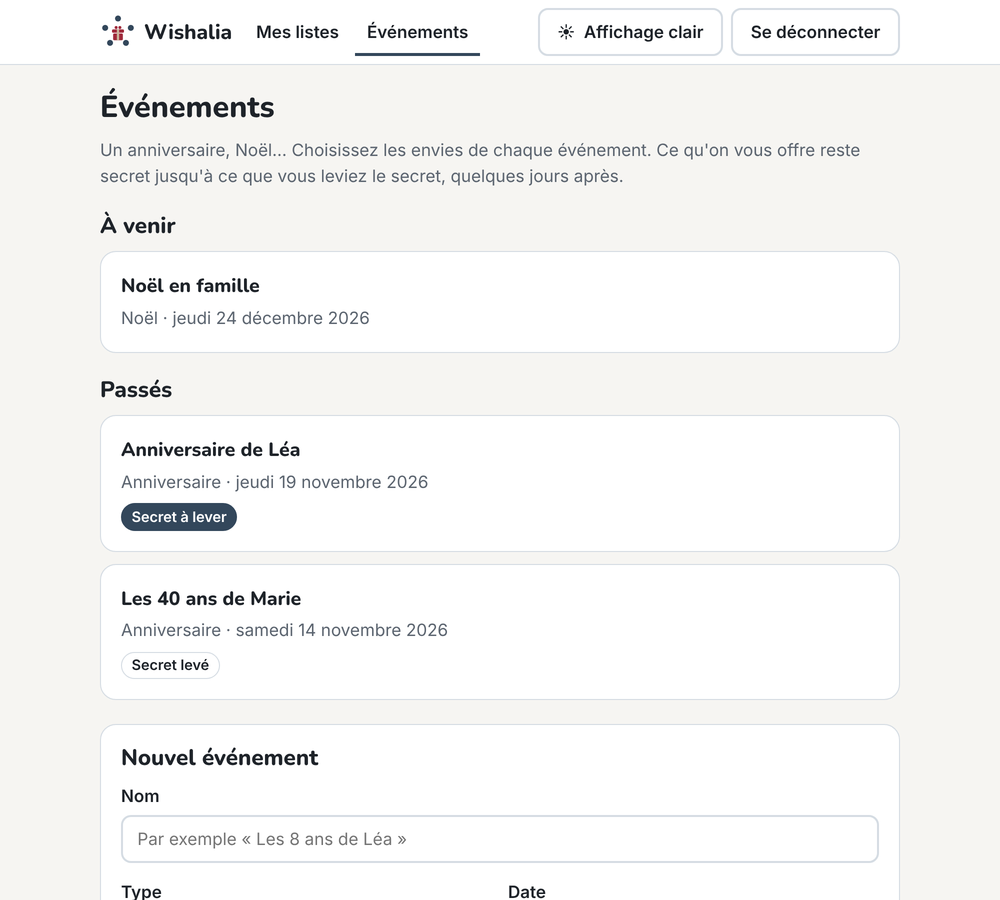
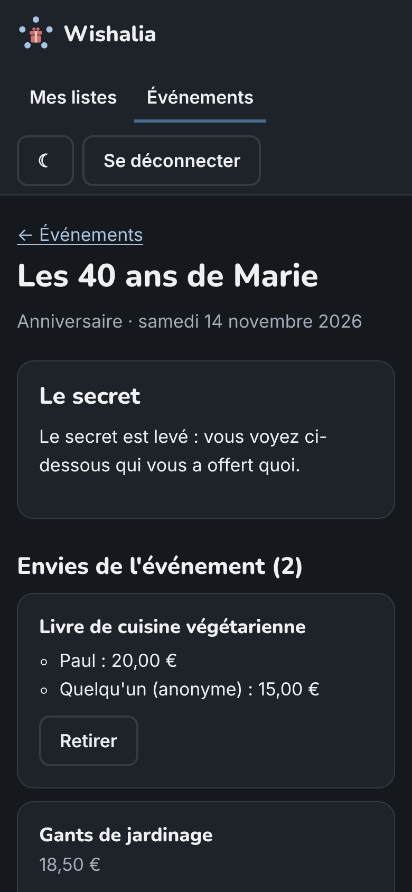
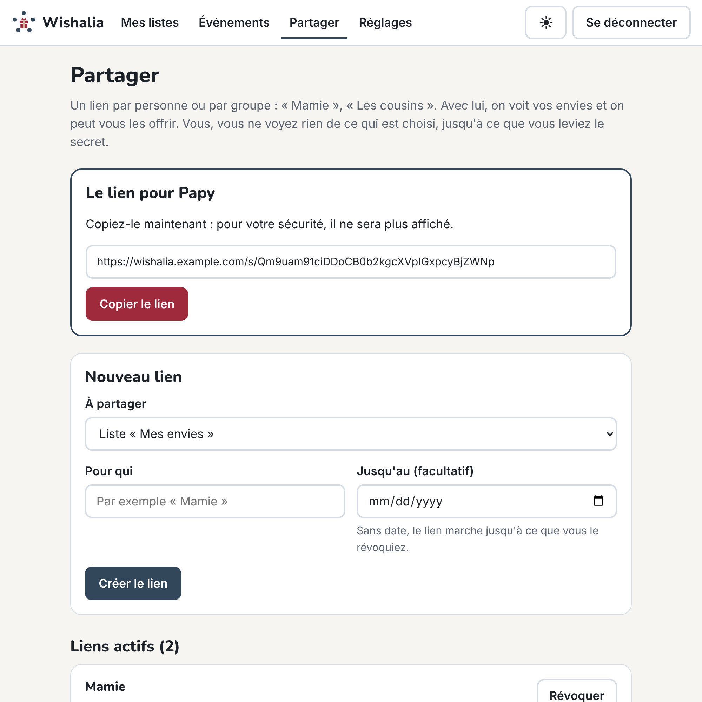
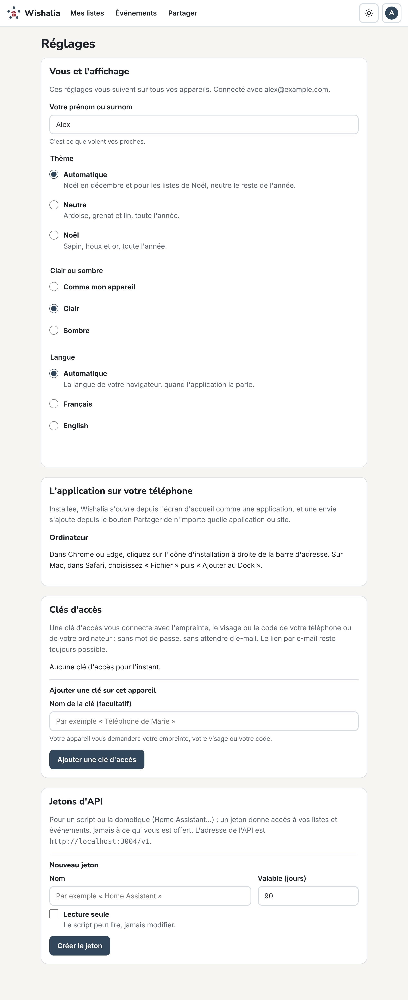

# Management app

The management app (`hosts.app`) is where the owner of the lists works: signing in, their lists,
the quick add, their events and the links they share. It speaks French and says « vous ». It calls the [Management API](api.md) server side
only: the browser never reaches the API.

Each list shows its picture next to its name, here and on its page: one of sixteen icons in the
theme's colours, or an image the owner sent. The picture next to a list's title opens « Image de la
liste », to change it ([Pictures of the lists](list-pictures.md)).

## Signing in

`/connexion` offers three ways in, all without a password:

- **A passkey**: « Se connecter avec une clé d'accès », and the passkeys of the device are also
  offered in the e-mail field's suggestions. The phone or computer asks for the fingerprint, the face
  or its code; nobody types an address. The button shows only where the browser can use passkeys.
- **A link by e-mail** (magic link): the person types their address and receives a link that signs
  them in, valid a few minutes. It needs `MAIL_FROM` and `SMTP_URL` (see
  [Configuration](configuration.md)).
- **Single sign-on**, when `OIDC_ISSUER` is set: a « Se connecter avec … » button, named by
  `auth.oidc.name`. See [Authentication](authentication.md).

A page opened without a session leads to `/connexion`, then back to that page once signed in (only
a path of the app: never another site). « Se déconnecter », in the account menu at the top right of
the bar, ends the session on the API.

## The header

The bar keeps the logo and the three places of the app on the left (« Mes listes », « Événements »,
« Partager »; under the bar on a phone), and two round icons at the top right:

- **the display** (half a disc, a sun or a moon, after the mode in use): a small menu with the mode
  (« Comme l'appareil », « Clair », « Sombre »), the theme (« Automatique », « Neutre », « Noël »)
  and the language. The choice in use is ticked and pressed for a screen reader. Each choice is a
  plain form to `/preferences`, kept with the account and on the device;
- **the account** (the first letter of the person's name): their name and address, « Réglages du
  compte » and « Se déconnecter ».

The menus open with a click, a tap or Entrée, and close with Échap (back on the icon), a click
elsewhere or the focus going away; they also open without JavaScript. Every icon says its words in a
tip, on hover and keyboard focus, and to a screen reader. The guests' pages have the same display
menu, and the public home page an icon to sign in (an arrow going in), or the account menu once
signed in ([Public view](public-view.md)).

## The foot of the pages

Every page of the app, the sign-in page included, ends with two things, on both frontends:

- **« Aide : le guide d'utilisation »**, with a question mark, opens the [user guide](user-guide.md)
  of the wiki in a new tab, in the page's language ([Guide d'utilisation](guide-utilisateur.md) in
  French). A server can lead it to its own help page with `config.helpUrl` (`HELP_URL`, see
  [Configuration](configuration.md)).
- **« Version 0.0.9 »**: the version that runs, to give when reporting a problem. It is the release
  of the image (`APP_VERSION`, set from the tag), or the version the app was built from for an
  image of a branch or a development run.

## Saved as you go

No setting has a « Enregistrer » button: the name, the theme or the mode of the account, a list's
settings, an item being edited, an event's settings, the name of a passkey, a list's icon, the image
chosen for an item and its framing are saved as they change. A typed field waits for a short pause
(0.8 s), a choice (a radio, a box, a list) goes at once, and leaving a field or pressing Entrée sends
what is left. A line under the form says « Enregistrement… », then « Enregistré » with a tick, to a
screen reader too.

Nothing typed is lost: when the server refuses a change (an empty name, a wrong price), the field is
marked, the line says what to fix in plain words, and what was typed stays; when the network is
lost, the line says so with « Réessayer ». One save goes at a time, and what changes meanwhile goes
right after it; the page reloading after a save never overwrites a field being typed in. A change to
the theme, the mode or the language reloads the page, which the server draws. Without JavaScript,
each form keeps an « Enregistrer » button.

Deliberate actions keep their button: adding an item, creating a list, a link, a token or a passkey,
lifting a secret, archiving and deleting.

## Saved in the background

The changes made on a list show at once and are saved behind, so the app never makes anyone wait
and every page stays free to use: deleting a wish (once confirmed), « Reçu », « Archiver », putting
it back on the list, reordering, moving a volume. They go to the server **one at a time, in the
order they were made**, so two changes never overtake each other, and several moves in a row send
only the latest order. Moving to another page does not stop them.

When the network is lost or the server does not answer (a restart, a timeout), the changes wait and
go again by themselves: after 1 second, then 2, 4… up to every 30 seconds, and at once when the
network comes back or the tab is shown again. They are kept on the device (the browser's storage,
only ids, a status, an order and a title), so closing the tab or reloading loses none of them: they
go at the next visit. The tabs of one browser share them, and only one sends at a time. Signed out
meanwhile, they wait for the next sign-in.

The header says where they stand, by an icon left of the display menu, with its words on hover and
to a screen reader: nothing once all is saved; a cloud with an arrow while changes go; a crossed-out
cloud while they wait, which tries again at once when tapped. When the server refuses a change (the
wish was deleted on another device), a message at the bottom of the page says which one, and the
list shows what is saved. Without JavaScript, each button posts its form as before.

## Lists and the quick add

The home page greets the person, then offers the **quick add**: one field for a link or a few words.
The item shows at once and the field empties for the next one; the worker completes the title and the
price from the link later ([Completing items from their link](enrichment.md)), and the page shows
each step by itself, with no reload ([Live updates](live-updates.md)). From the home page the item goes into the first list (« Mes
envies », created by the very first add), from a list page into that list.

When the link is already in one of the person's open items, the app says so and offers to undo the
add, rather than asking before it.

Installed on a phone, the app is also in the system's **share menu**: « Partager », then
« Wishalia », opens « Ajouter une envie » (`/ajouter`) with the shared link and its title in the
field, a choice of list, and one « Ajouter à ma liste » button. The page never adds on its own: the
person sees what will be added and confirms with one tap. On iPhone, a Shortcut does the same. See
[Install the app](install-app.md).

Wishes kept on another service come in with « Importer une liste » (`/importer`, linked under the
lists): a Wishlistr list from its address, a CSV or JSON file (an export, a spreadsheet), or a text
pasted with one wish per line. The page shows what it found, every wish ticked, and the person
unticks what they leave out, then picks a list (a new one, named after the source's list, or one of
theirs) and confirms. The list page then says how many came in. See [Importing a list](import.md).

A list page shows its items, newest first. Every card has the same grid: the arrows to reorder it,
a square for its image, its name with what kind of gift it is, its price and the site of its link,
then its icons, always in the same order and lined up from one card to the next. An item without an
image keeps its square, an empty frame, so that nothing moves; while its link is read, the square
breathes. The icons, each with its words in a tip:

- a **heart**, « Je l'ai reçu »: the item is received;
- a **pencil**, « Modifier »: the item opens in place, under its card;
- two **turning arrows**, « Recharger », for an item with a link: its link is read again (a new
  price, a better photo), and « Recharger les liens », next to the title, does it for the whole list;
  what the person typed or sent stays ([Reading a link again](enrichment.md#reading-a-link-again));
- a **box**, « Archiver », and a **bin**, « Supprimer » (after a dialog).

Over the image's corner, a small pencil leads to the item's images (a « + » on an empty frame), as
the count of images sits over the other corner. Received and archived items wait under « Reçues et
archivées », with a heart or a box, where the arrow coming back puts them back in the list. Every
change lands in the item's history. See [Archiving and deleting](archive-delete.md).

The open items can be put in any order, the one relatives see them in. Each card has a handle to
drag with a mouse or a finger, as many places up or down as wanted in one go (the cards make room
as it passes, and the page scrolls along near its edges), and two arrows, « Monter » and
« Descendre », that move the item one place in a single tap or from the keyboard (they also work
without JavaScript). The new place shows
at once and a screen reader hears it (« « Lampe » est maintenant en position 2 sur 5. »); the
keyboard stays on the moved item. Moves follow one another without waiting for the server (see
« Saved in the background »): only the latest order is sent, and the page shows its own order until
it is saved, so an answer never brings an item back to where it was a moment ago. An order a moment
behind is merged, not refused: a wish deleted, received or archived meanwhile is left out, and one
added meanwhile (on this device or another) stays at the top, where a new wish lands.

### The preview

The eye button next to the list's title (« Aperçu » in its tip), shows the list as the owner's relatives see it through a share
link: the same cards, drawings and words, the list's theme, what is still to give first. The gifts
on it are **made up** for the preview (« Camille (exemple) », « Hugo (exemple) », someone anonymous),
and the page says so: they are built from the items alone, and the page never asks the API for a
history or a contribution, so the preview can give nothing away. The relatives' buttons to give are
left out; the page says they have one under each item.

### A list's settings

« Réglages de la liste », the cog next to the list's title, opens under it (its link, `?reglages`,
opens it without JavaScript too). Saved as they change, it holds:

- its **name**;
- its **picture**, « Changer l'image » ([Pictures of the lists](list-pictures.md));
- **who can see it**: « Privée » (the default), seen only by the people you send a share link to,
  or « Publique », found from the [home page](public-view.md#the-home-page) by your name or the
  list's, where anyone may take part. A public list gets its own address, shown under the choice to
  copy; turning it private again cuts that address at once, and leaves the share links as they are.
  On a public list, guests never see who else gives;
- its **theme**: « Celui de chacun » (everyone sees their own), « Neutre » or « Noël », forced on
  everyone who opens the list, in the app and through its share links; the light or dark mode
  stays each person's own. A new theme reloads the page, since the server draws it;
- **the gifts made without an event**: when their secret lifts, « Quand je marque l'envie reçue »
  (each item's secret lifts once it is received, the default) or « Quand je le décide » (the whole
  list at once). The choice is frozen once the secret is lifted;
- in « Quand je le décide » mode, « Lever le secret de la liste », behind a box to tick: final;
- « Archiver ou supprimer »: the box archives the list, which leaves the lists, and its share links
  show nothing any more; the app goes back to the lists and says so, and the list waits under
  « Listes archivées » on the home page, to restore or delete it. The bin deletes the list and its
  items for good, after a dialog ([Archiving and deleting](archive-delete.md)).

### Editing an item

The pencil, « Modifier », opens the item in place, under its card (its link, `?modifier=<id>`,
does it without JavaScript), and the cross folds it back. Every field is saved as it changes: its name, what kind of gift it is, its price,
its list, its link and notes for the family. The kind is a choice of four, each with a line that
says what it means:

- **Un cadeau**: one person reserves it; « À chaque occasion » makes it a gift that can be given
  again at every event (it is then never marked received);
- **Plusieurs exemplaires**: how many are wanted, from 1 to 1,000; each guest reserves one or more;
- **Une cagnotte**: a target in euros, optional; each guest chips in what they want, past the target
  if they like;
- **Une série**: the wish becomes the first volume of a new series, one card with its volumes inside,
  each given on its own (see [Series](series.md)).

Only the fields of the kind chosen show, by CSS, so the form works the same without JavaScript.
Amounts are typed as the person writes them (« 24 », « 12,50 »). A link is cleaned like in the quick
add, and anything that is not an `http(s)` address is refused. When something is wrong, the field
keeps what was typed and the line under the form says what to fix. Moving an item to another list takes it off
the page, and the page says so. The API writes the history: `updated`, `price_changed`, `moved`.

## Images

The small pencil over an item's image (a « + » on an empty frame) opens its page. It shows the image
the family sees, lets the owner frame it in a square (drag, tap, arrow keys or a slider), choose
another of the images found on the page of the link, or send their own photo, up to 10 MB: the
framing, the image chosen and the photo sent are saved at once. A click on an item's thumbnail opens its images
big, in the page, to go from one to the next and close with the cross, Échap or a click outside. See
[Images](images.md) for the details.

## Events

« Événements » (`/evenements`) lists the person's events, upcoming first, then past ones, the most
recent first. A past event whose secret can be lifted says so. An event has a name, a type
(birthday, Christmas, other), a date and a delay before its secret can be lifted (3 days by
default). A Christmas event is shown in the Christmas theme, unless the person chose another one.

An event's page shows:

- **The secret**: when it can be lifted (the end of the event day plus the delay). From then on, a
  « Lever le secret » button, behind a checkbox that confirms the choice, which is final.
- **The event's items**, which can be removed, and below them the open items of every list, to add
  in one tap. An item stays in its list: the event only selects it.
- **Its settings**, folded away and saved as they change. Once the secret is lifted, the date and the
  delay no longer change.

Once the secret is lifted, each item shows who gave what for this event: the amount of each
contribution, or the reservation, under the name the guest gave (« Quelqu'un (anonyme) » when they
chose to stay anonymous), with the word they left for the owner, if any. Before, the API gives
nothing of it: the page cannot show what the owner must not see.

The gifts made without an event show the same way on the list's page, under each item, once their
secret lifts: when the item is marked received, or when the list's secret is lifted in « Quand je le
décide » mode.

## Sharing

« Partager » (`/partage`) makes one link per guest or per group, « Mamie », « Les cousins », for a
list or an event. A list page (the share button, three linked dots, next to its title) and an event page lead there with that one already chosen. A link may
end on a chosen day; without one, it works until it is revoked.

The link's address is shown **once**, right after it is made, with « Copier le lien » (and « Envoyer…
» where the device can share): only its hash is kept, so it can never be shown again. Making a link
also marks the device as the owner's (`__Secure-wishalia.owner_device`), so that the public view
recognises them and spoils nothing, even without a session.

The active links list who each one is for, what it shares and until when. « Révoquer » asks once
more, then the guest's link answers like an unknown one, for good. Revoked and expired links wait
folded at the bottom.

## Settings

« Réglages » (`/reglages`) holds what follows the person on every device, stored with their
account (`PATCH /manage/me`), saved as they change; « Réglages du compte », in the account menu,
leads there:

- the first name or nickname their family sees;
- the **theme**: `Automatique` (Christmas in December and for Christmas lists, neutral otherwise),
  `Neutre` or `Noël`;
- **light or dark**: as the device, light or dark. The header's display menu changes the same
  settings;
- the **language** (« Langue », « Language »): `Automatique` (the browser's), `Français` or
  `English` ([Languages](i18n.md)). A new language reloads the page.

The device keeps a copy in its cookies (`wishalia.theme`, `wishalia.mode`, `wishalia.locale`), so
that the sign-in page looks the same before the person signs in again. The sign-in page also has a
button for the other language.

The **passkeys** (« Clés d'accès ») are listed with their name, the day they were added and whether
the phone or computer's password manager syncs them on all its devices. « Ajouter une clé d'accès »
creates one on this device, under the name typed or one guessed from the device (« iPhone »,
« Mac »...); each can be renamed (the pencil, saved as typed) or deleted (the bin). Adding a passkey needs a sign-in of less than a day: an
older session is asked to sign in again, and comes back to the settings. A device that already holds
a passkey of the account is told so. Passkeys need JavaScript; without it, or in a browser without
them, the page says so and the link by e-mail remains.

« L'application sur votre téléphone » shows how to install the app on the device in hand (Android,
iPhone and iPad, computer; every set of steps without JavaScript), an « Installer Wishalia » button
where the browser offers one, and the address an iPhone Shortcut opens, with « Copier l'adresse ».
See [Install the app](install-app.md).

When the REST API v1 is on (`hosts.api`), the page also manages the **API tokens**: a name, a
lifetime of 1 to 365 days (90 by default) and an optional read-only mode. A new token is shown once,
with « Copier le jeton »; the list shows each one's first characters, its end and when it was last
used, and « Révoquer » (the bin) ends it for good. See [REST API v1](rest-api.md).

## Themes and accessibility

- The header's display menu chooses the device's mode, light or dark, and the theme. The choice is
  kept with the account and on the device (`wishalia.mode`, `wishalia.theme` cookies), and applied
  by the server, so the page never
  flashes in the wrong colours. A theme forced by a list (`theme` of the list) colours its page, in each
  person's mode. See [Branding](branding.md).
- Every page passes axe (WCAG 2.2 AA) in light and dark, on a phone and a computer: contrast of
  4.5:1 or more, 48 px touch targets, visible focus, a « Aller au contenu » skip link, labels on
  every field and spoken feedback after each action.
- Forms work without JavaScript; with it, they answer without reloading the page.

The guests' screens are in [Public view](public-view.md).
