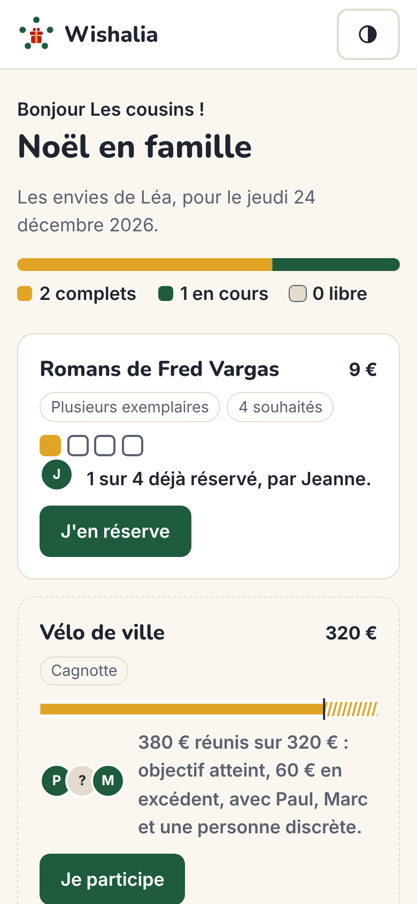
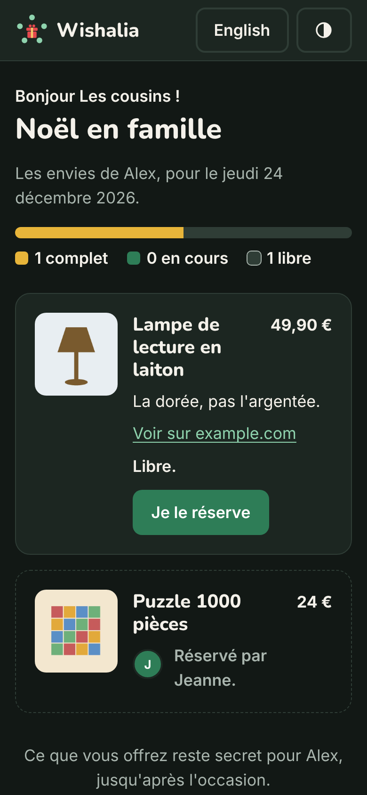
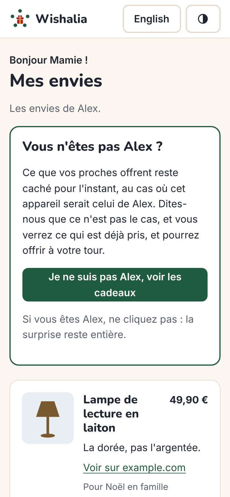
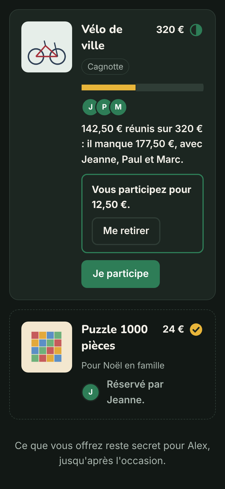
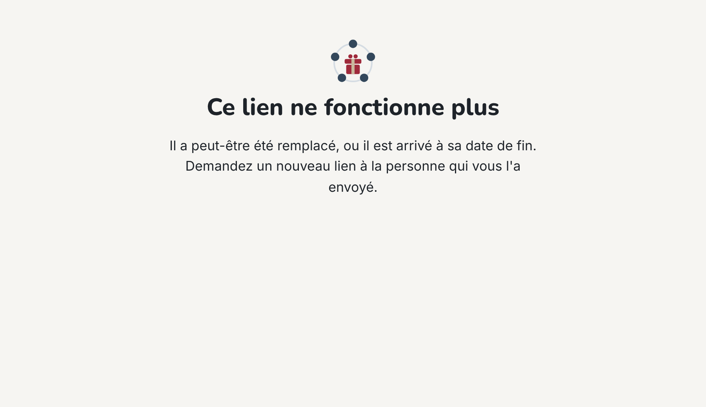

# Public view

The public view (`hosts.public`) is what the family sees when they open a share link: no account,
no sign-in, just the link the owner sent them. It speaks French and says « vous ». It calls the
[Public view API](public-api.md) server side only: the browser never reaches the API.

## A share link

A link looks like `https://<hosts.public>/s/<token>`. The owner makes one per guest or group in the
management app ([Sharing](management-app.md#sharing)), for a list or for an event. The page sends
the token to the API in a header, never in a URL of its own, so that it stays out of the access
logs and of the metrics (they record `/s/[token]`).

The page greets the person the link was made for (« Bonjour Mamie ! »), then shows:

- the list's name and whose wishes they are, or the event's name and day;
- on a list link, the open events coming up (« Prochaine occasion : Noël en famille »), and under
  each item the events it is picked for;
- every item with its price (or the pool's target), its notes, a link to the site it comes from
  (opened in a new tab, only an `http(s)` address), and where it stands:
  - a gift: « Libre. » or « Réservé par Paul. »;
  - several copies: one box per copy, filled when reserved, and « 1 sur 4 déjà réservé, par
    Jeanne. »;
  - a pool: a bar split by event (one colour per event, named under the bar when there are
    several), on the scale of the target or of the total when it is passed, with a mark at the
    target and the overshoot hatched past it; and « 130 € réunis sur 320 € : il manque 190 €, avec
    Paul et une personne discrète. », or « objectif atteint, 60 € en excédent » once passed;
  - « Presque complet » from 80 %;
  - a gift for every occasion: how many times it was given;
  - a received item: « Déjà reçu : merci ! ».

Next to where an item stands, the givers' initials, stacked (« ? » for someone discreet). Above the items, where the
event or the list stands: « 2 complets, 1 en cours, 0 libre », with a bar in the same colours.
Every drawing repeats what the words say, so nothing is told by colour alone, and the drawings are
SVG attributes, never `style` attributes, which the page's CSP refuses.

Between guests, a contribution shows its author's name, or « une personne discrète » when they chose
to stay anonymous, never its amount. Items still to give come first, in the owner's order; those
already given or received follow, quieter, with a dashed border.

## A visitor nobody knows

The API recognises the owner by their session or their device marker, but the owner may open their
link on a device that has neither: a borrowed phone, a private window, a new computer. So when
nobody is known on the device (no account, no gift given from it on this link, no answer yet), the
page leaves what others give **out of the page** (states, progress, names, the give buttons) and
asks first: « Vous n'êtes pas Léa ? », with a « Je ne suis pas Léa, voir les cadeaux » button and
« Si vous êtes Léa, ne cliquez pas : la surprise reste entière. » The items keep the owner's order,
so that the order gives nothing away either.

The answer is kept on the device for that link only, in an `HttpOnly` cookie (`wishalia.unfolded`,
path `/s/<token>`, 400 days): the person is asked once per link and device. A guest signed in with
an account, or who already gave from this device, is not asked. It works without JavaScript; with
it, the page stays in place and the focus goes back to the title.

## Giving

Under every item still open, one button says what it does: « Je le réserve » for a gift,
« J'en réserve » when several copies are left, « Je participe » for a pool. It opens a short form,
in the page, that asks only what the gift needs:

- for a pool, the amount in euros (« 20 » or « 12,50 »), with what is still missing; giving more
  than the target is allowed;
- for several copies, how many (up to what is left);
- the person's first name, when they have no account (it is kept on the device for the next time);
- an optional word for the owner (« À lire après l'occasion, avec le cadeau. »), 500 characters at
  most;
- « Rester discret »: nobody sees their name, not even the owner.

On a list link, when the item is picked for more than one open event, the form asks which one the
gift is for; with one open event it goes to that event without asking. An event link gives to its
event. The page then thanks the person (« Merci, c'est noté ! Léa n'en saura rien avant
l'occasion. ») and shows their gift on the item: « Vous l'avez réservé. », « Vous en réservez 2. »,
« Vous participez pour 12,50 € », with a « Me retirer » button. Someone who chips in to a pool can
chip in again.

When the gift cannot be taken, the form stays open with what was typed and says why, in words: the
item was reserved in the meantime (« Quelqu'un vient de le réserver. Regardez les autres envies ! »),
fewer copies are left, the amount is missing, the name is missing, or the occasion is past.

### Withdrawing

« Me retirer » takes the gift back, as long as the secret of its event is kept and the item is not
received. A guest with an account withdraws by their session; a guest without one by the withdraw
key the API gave once, kept on their device:

- in an `HttpOnly`, `SameSite=Lax` cookie, `wishalia.gifts`, scoped to the link's path
  (`/s/<token>`), so that the page's JavaScript never reads it and another link never receives it;
- for 400 days, and the 30 latest gifts of that link (a cookie holds about 4 KB);
- the first name goes in `wishalia.guest_name`, also `HttpOnly`.

On another device, or after clearing the cookies, the gift stays given, but that device does not
know it is theirs and cannot withdraw it. With an account, their gifts follow them on every device.

## When the owner opens their own link

The API recognises the owner by their session or by the device marker put on their device when
they made or copied a link (see [Public view API](public-api.md#who-is-looking)). The page then says
so, and shows the items **without anything about who gave what**: no state, no progress, no names,
and no button to give (the API refuses it anyway).
The order gives nothing away either: what is given is not moved down for the owner, since their view
has no funding to sort by.

## A link that no longer works

An unknown, revoked or expired link gives the same page, with the same words, so that nobody can
tell them apart: « Ce lien ne fonctionne plus. Demandez un nouveau lien à la personne qui vous l'a
envoyé. » A token that cannot be one is answered the same way without asking the API.

## Privacy

- Every page has the same title and link preview (« Wishalia · une liste de souhaits »): a preview
  in a chat never tells the owner, or anyone, what is on the list.
- Nothing is indexed: `noindex, nofollow` in the page and in an `X-Robots-Tag` header.
- The page of a link is never cached (`Cache-Control: private, no-store`).
- `Referrer-Policy: same-origin`: following an item's link never gives the share link to that site.

## Themes and accessibility

The page follows the list's forced theme when it has one; otherwise the person's choice, with the
Christmas theme in December and for a Christmas event. The header button switches between the
device's mode, light and dark, kept on the device (`wishalia.mode`). Every page passes axe (WCAG 2.2
AA) in light and dark, on a phone and a computer, and works without JavaScript, giving and
withdrawing included.
