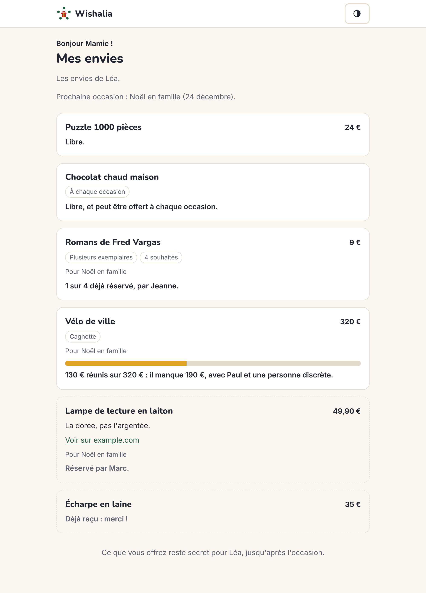
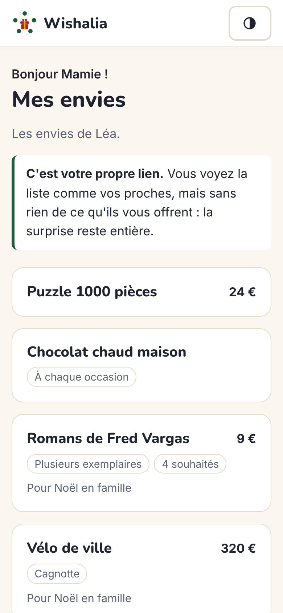

# Public view

The public view (`hosts.public`) is what the family sees when they open a share link: no account,
no sign-in, just the link the owner sent them. It speaks French and says « vous ». It calls the
[Public view API](public-api.md) server side only: the browser never reaches the API.

## A share link

A link looks like `https://<hosts.public>/s/<token>`. The owner makes one per guest or group in the
management app ([Sharing](management-app.md#sharing)), for a list or for an event. The page sends
the token to the API in a header, never in a URL of its own, so that it stays out of the access
logs and of the metrics (they record `/s/[token]`).

The page greets the person the link was made for (« Bonjour Mamie ! »), then shows:

- the list's name and whose wishes they are, or the event's name and day;
- on a list link, the open events coming up (« Prochaine occasion : Noël en famille »), and under
  each item the events it is picked for;
- every item with its price (or the pool's target), its notes, a link to the site it comes from
  (opened in a new tab, only an `http(s)` address), and where it stands:
  - a gift: « Libre. » or « Réservé par Paul. »;
  - several copies: « 1 sur 4 déjà réservé, par Jeanne. »;
  - a pool: a progress bar and « 130 € réunis sur 320 € : il manque 190 €, avec Paul et une
    personne discrète. », or the overshoot once the target is passed;
  - a gift for every occasion: how many times it was given;
  - a received item: « Déjà reçu : merci ! ».

Between guests, a contribution shows its author's name, or « une personne discrète » when they chose
to stay anonymous, never its amount. Items still to give come first, in the owner's order; those
already given or received follow, quieter, with a dashed border.

## When the owner opens their own link

The API recognises the owner by their session or by the device marker put on their device when
they made or copied a link (see [Public view API](public-api.md#who-is-looking)). The page then says
so, and shows the items **without anything about who gave what**: no state, no progress, no names.
The order gives nothing away either: what is given is not moved down for the owner, since their view
has no funding to sort by.

## A link that no longer works

An unknown, revoked or expired link gives the same page, with the same words, so that nobody can
tell them apart: « Ce lien ne fonctionne plus. Demandez un nouveau lien à la personne qui vous l'a
envoyé. » A token that cannot be one is answered the same way without asking the API.

## Privacy

- Every page has the same title and link preview (« Wishalia · une liste de souhaits »): a preview
  in a chat never tells the owner, or anyone, what is on the list.
- Nothing is indexed: `noindex, nofollow` in the page and in an `X-Robots-Tag` header.
- The page of a link is never cached (`Cache-Control: private, no-store`).
- `Referrer-Policy: same-origin`: following an item's link never gives the share link to that site.

## Themes and accessibility

The page follows the list's forced theme when it has one; otherwise the person's choice, with the
Christmas theme in December and for a Christmas event. The header button switches between the
device's mode, light and dark, kept on the device (`wishalia.mode`). Every page passes axe (WCAG 2.2
AA) in light and dark, on a phone and a computer, and works without JavaScript.

Coming next: contributing from this page (reserving, chipping in, withdrawing).
