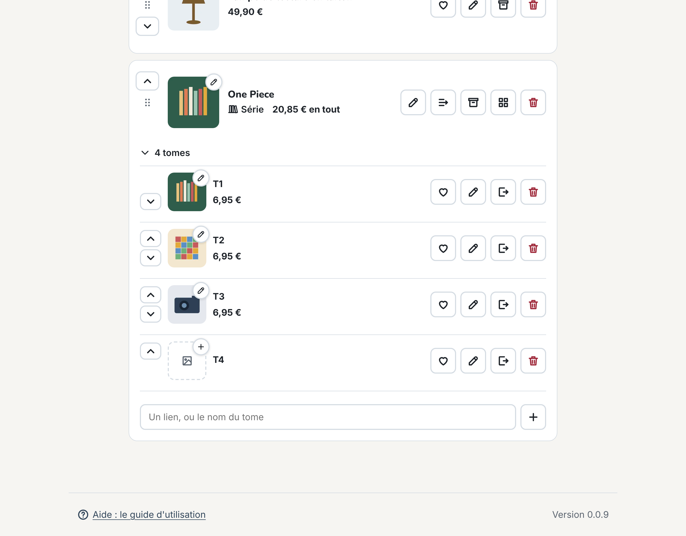
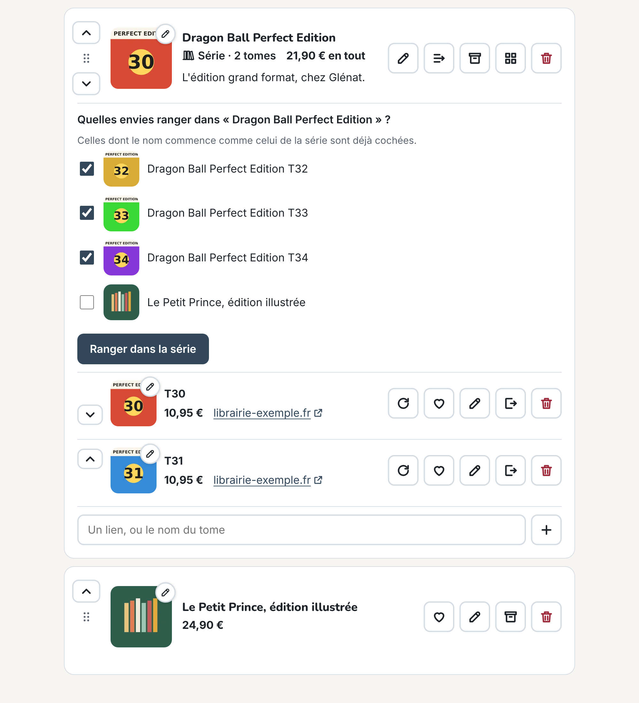
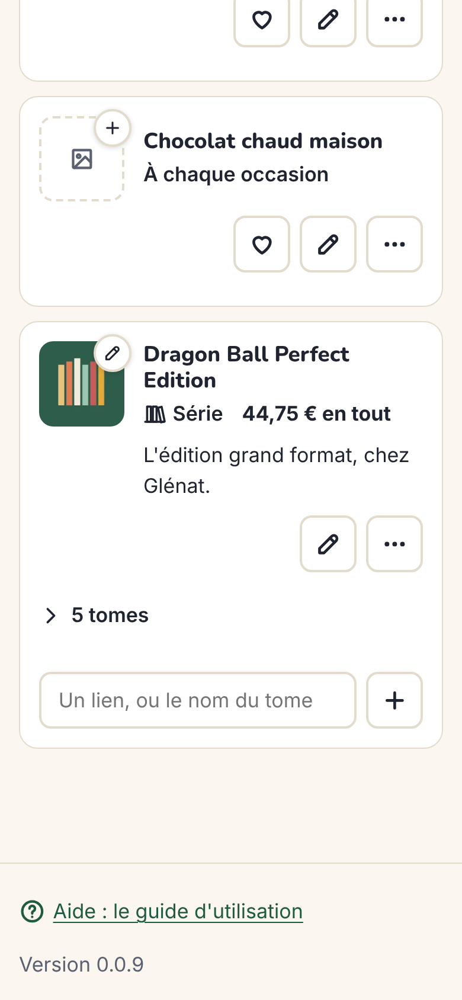
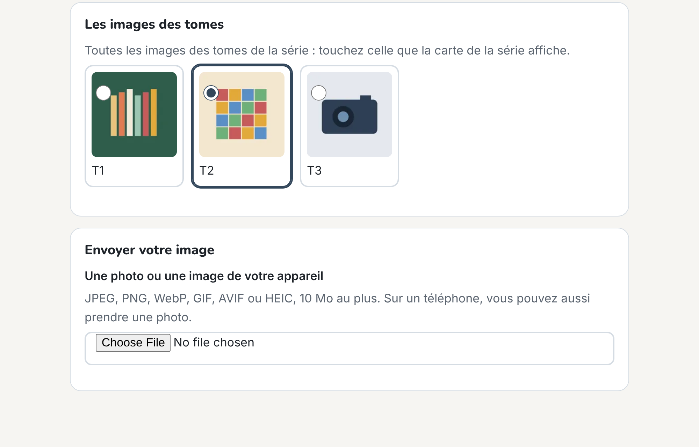
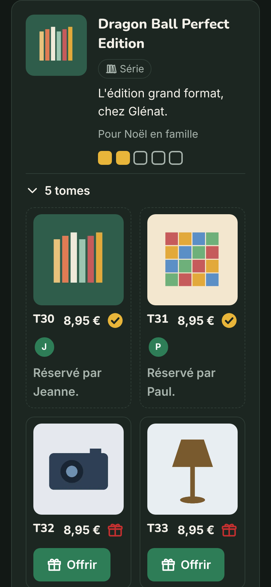
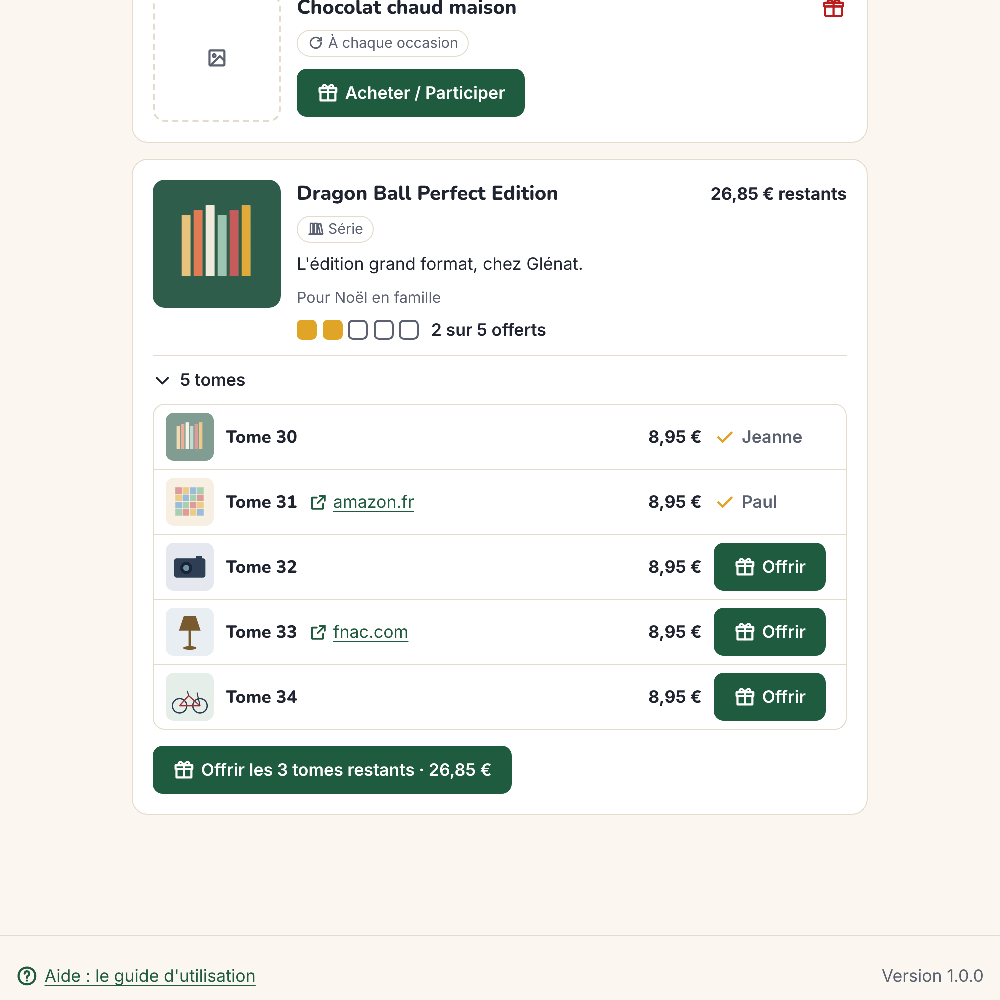

# Series

A **series** gathers volumes that go together, such as the tomes of a book, comic or manga series,
or the boxes of a collection. It is the fourth kind of wish, beside « Un cadeau », « Plusieurs
exemplaires » and « Une cagnotte ». On the list, a series is **one card**, the way a gift wanted in
several copies is: its name, its notes, how many volumes it holds and what they cost together, with
its volumes listed inside it.

Each volume is an ordinary wish of the same list: its own name or number (« T30 »), its price, its
link (read like any other, see [Enrichment](enrichment.md)), its images, and its own button for the
guests. Relatives give the volumes **one by one**: one reserves T30, another shares T32, T33 is
still to give.

## Making a series

There are two ways, and both start from wishes already in the list:

- **From a wish.** The pencil of a wish, then « Une série » as its kind. The wish becomes the first
  volume of a new series, named after it without the number at its end (« Dragon Ball Perfect
  Edition T30 » makes the series « Dragon Ball Perfect Edition »).
- **Putting wishes into it.** The series' button « Ranger des envies dans la série » (lines with an
  arrow) opens the list's other wishes, each with its square. Those whose name starts like the
  series' are already ticked, in their reading order (T2 before T10); « Ranger dans la série » puts
  them in, after its last volume.

The field at the bottom of the card adds a new volume, as the quick add does: a link, or a few words.

When volumes are grouped, nothing about them changes: their gifts, their images, their history stay.
A volume keeps its whole title; inside its card, the series' name is left out of it (« T30 »), and
it comes back whole when the volume leaves the series.

## On the card

| Icon                           | What it does                                                                                                            |
| ------------------------------ | ----------------------------------------------------------------------------------------------------------------------- |
| Three small rings (series)     | The series' menu: « Ranger des envies dans la série », « Défaire la série », archive and delete.                        |
| Pencil (on the series)         | The series' name, its notes for the family (the edition, the publisher), its list: a series moves with all its volumes. |
| Lines with an arrow            | « Ranger des envies dans la série ».                                                                                    |
| Box                            | Archive the series: it and its volumes leave the guests' view, until it is restored.                                    |
| Four squares                   | « Défaire la série »: its volumes become wishes of their own again, where the series stood.                             |
| Bin                            | Delete the series **and every volume**, for good (see [Archive and delete](archive-delete.md)).                         |
| Arrows of a volume             | Move it up or down in the series. The series itself moves in the list like any card.                                    |
| Heart, pencil, reload (volume) | As for any wish: received, edited in place, link read again.                                                            |
| Arrow leaving a box (volume)   | « Sortir de la série »: the volume becomes a wish of its own, first in the list.                                        |

The volumes are **tiles**, as many to a row as fit: the volume's square, its short name (« Tome 30 »,
from the number in its title),
its price, and two icons, its pencil and its menu « ⋯ » (its site, received or reopen, read the link
again, take it out of the series, delete it). The volume being edited opens under the tiles. In
« Réorganiser », the series' row shows its volumes as small tiles with « ‹ » and « › » to move one
place, shown at once and saved in the background.

The volumes fold under « 5 tomes »: a chevron unfolds them, and they stay open while one of them is
being edited. The field that adds a volume stays under the card, folded or not; adding a volume
unfolds the card to show it, and a card the owner unfolded stays so as the page reloads. The series'
square shows the image chosen for it, or else the first volume's. Its pencil opens « Image de … »,
which offers, under « Les images des tomes », **every image of every volume**, volume by volume in
their order, each named after its volume (« T30 », « T31, image 2 »): a tap shows it on the series'
card, framed as the owner likes, for the guests too. A photo of the owner's own works as for any
wish. When the volume's image goes, the series shows its first volume's again. The count of wishes of a list
counts the volumes one by one, never the series.

## For the guests

The guests see one card too: the series' name and notes, « Série », and one box per volume, filled
once it is given, like a gift wanted in several copies (a screen reader hears « 3 tomes sur 5
encore à offrir »; past 24 volumes, these words show instead). The volumes show as **tiles** under
« 5 tomes », open for a series of ten volumes or fewer, folded beyond: every tile has its square,
its short name (« Tome 33 », from the number in its title, whatever else the title says; its whole
title on hover), its price and its badge on the line under it, the shop's name with the arrow that
leaves (« fnac.com »), its badge (to give, partly given, given, received) and « Offrir », the
same form as every wish: a volume with a price can be bought whole or shared, like any gift (see
[Public view](public-view.md#giving)). The tile whose form is open takes the whole row. The series
itself takes no gift.

Under the tiles, **« Offrir les 3 tomes restants · 26,85 € »** buys every volume still free at once
(from two to twenty: a guest without an account keeps the keys of their last thirty gifts on the
device), each one whole, with the same occasion, name and word; a volume taken meanwhile stops it
there, the ones before it kept, and the form says why.

A series is complete once every volume is: it then goes down the list, as a complete gift does. In
the owner's own view and in the preview, nothing says who gave what (anti-spoil, see
[Security](security.md)).

## Events

An event selects the **series**, never a volume alone: adding the series brings every volume, and a
volume added later is in the event too. On a list link, a volume is for the events of its series.
Once an event's secret is lifted, its page gives who gave what for each volume, under the series.

## In the API

A series is an item of `kind: "series"` with no link, price, target or quantity of its own; its
volumes are items whose `parentId` is the series. `GET /manage/lists/:id/items` gives them all, the
volumes with their `parentId`. See [Management API](api.md#series) and [REST API](rest-api.md). The
history writes `grouped` and `ungrouped` on each volume that goes into or out of a series.
