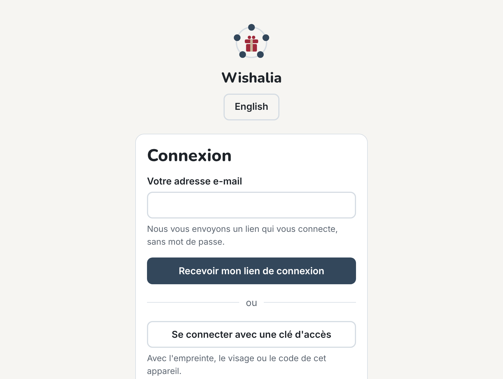
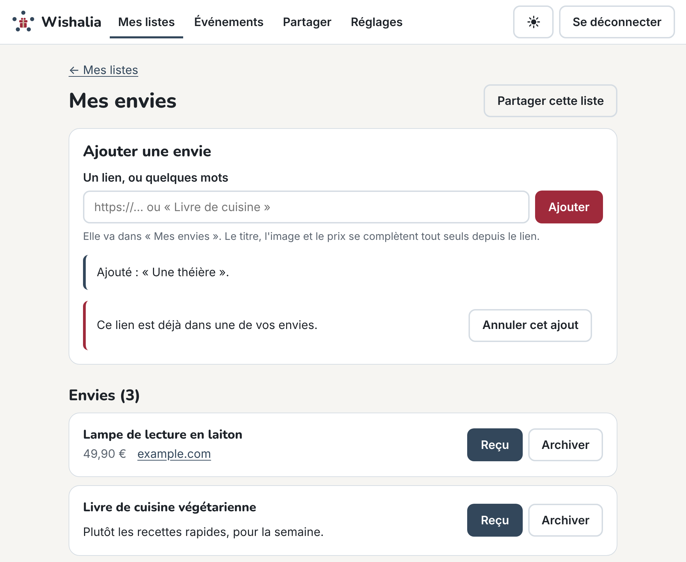
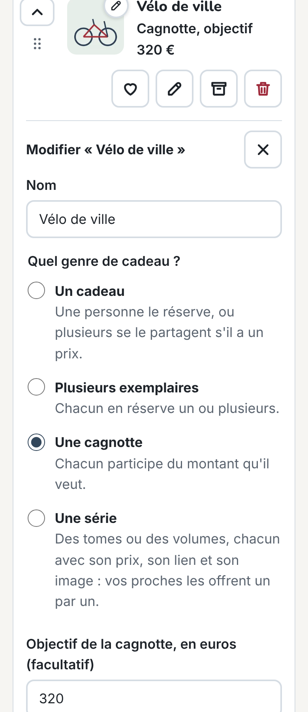
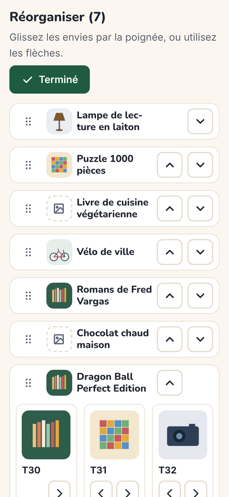
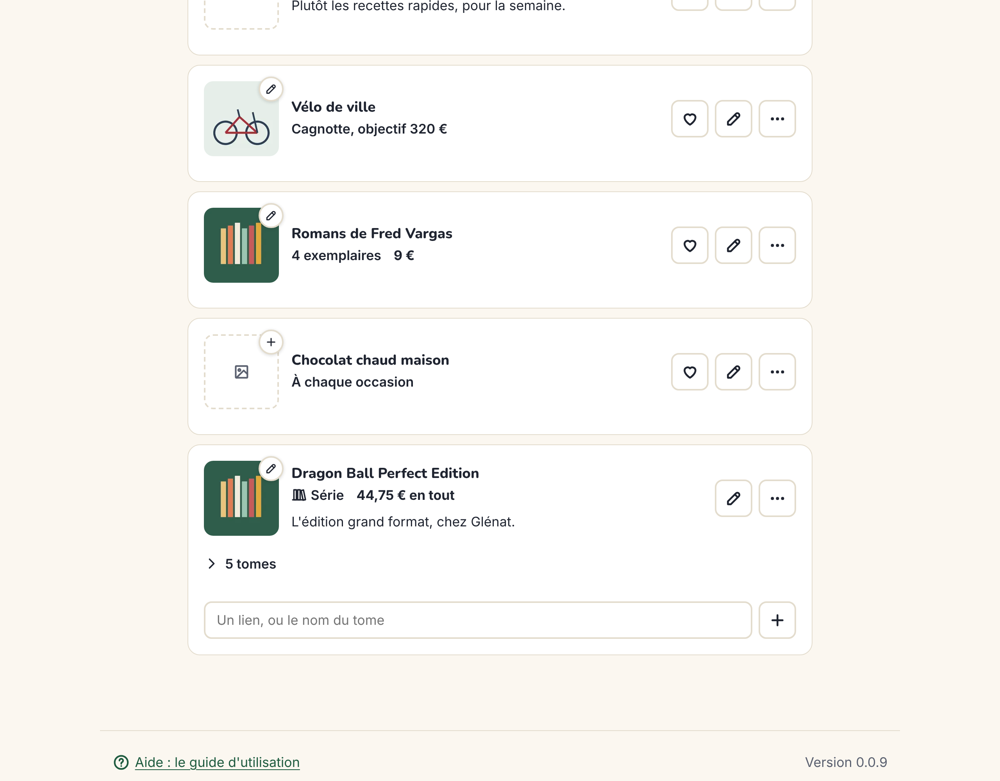
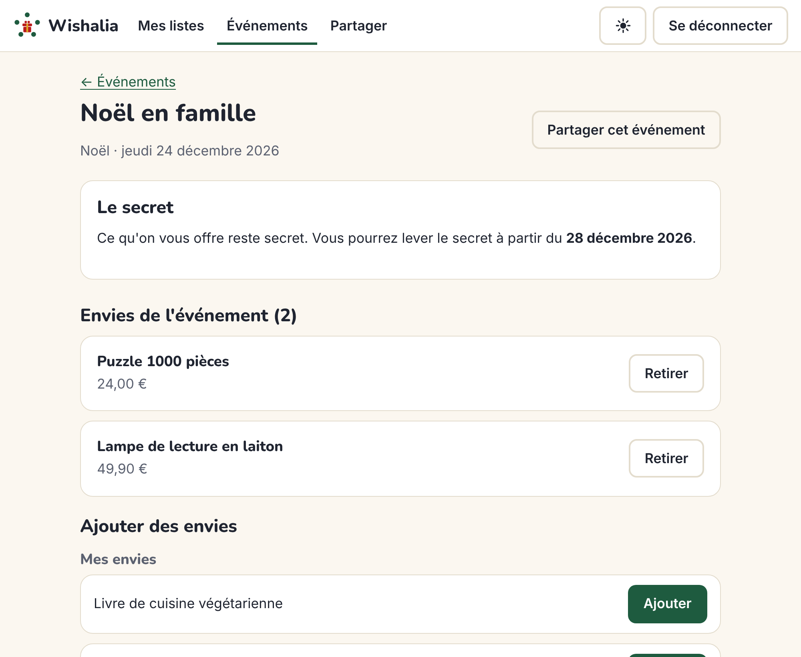
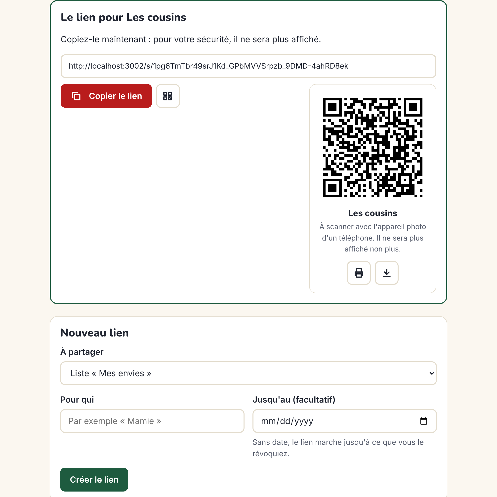
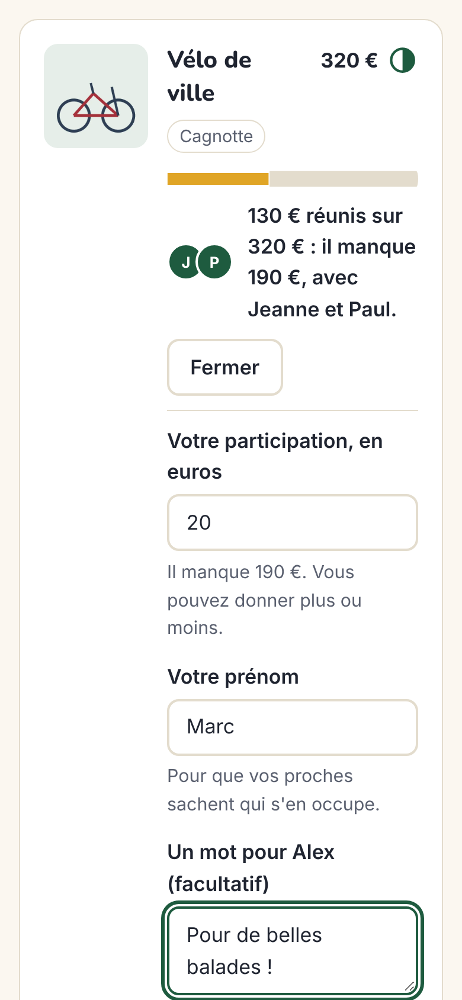

# User guide

This guide explains Wishalia to the whole family, without jargon: making a wishlist, sharing it,
and giving a gift without spoiling the surprise. The link « Help: the user guide », at the foot of
every page, opens it. (En français : [Guide d'utilisation](guide-utilisateur.md).)

The screens below are in French; in English, the same buttons carry the same icons.

Wishalia has two sides:

- **the app**, where you make your lists (the address the person who installs it gave you, such as
  `app.wishalia.example.com`);
- **the guests' view**, the page the people you send a link to open: they see your wishes there and
  choose what they give.

## The golden rule: the surprise

You **never** see who gives what, or how much, before you **lift the secret**, a few days after the
occasion (a birthday, Christmas…). Your relatives do see what is already taken, so that nobody gives
the same thing twice.

## Signing in

The « Sign in » page offers three ways in, without a password:

- **a passkey**: the phone or computer asks for the fingerprint, the face or its code;
- **a link by e-mail**: type your address, open the e-mail and tap the link;
- **the button of your sign-in provider**, when the person who installs Wishalia set one up.

## Making your list

### Adding a wish

The field at the top of the home page adds a wish in one go: paste a **link** to a shop's page, or
type **a few words** (« A blue jumper, size M »), then Enter. The wish is there at once; with a link,
Wishalia reads the page and fills in the name, the price and the images by itself.

On a phone, the **barcode** beside the field opens the camera: aim at a book's barcode, and « Add »
puts it in the list with its title. For a **series** (the volumes of a collection), add the first
volume as a wish, then pick the kind « A series » (see below).

Past a few wishes, the **magnifier** at the top of the list finds a wish by its name or notes.

### Editing a wish

The **pencil** of a wish opens it in place: its name, its price, its link, your notes for the
family, its kind. Everything is saved as you type, with no « Save » button.

The kind says what your relatives can do:

- **A gift**: one person gives it, or several share it;
- **Several copies**: three pairs of socks, say; the − and + buttons set how many;
- **A pool**: everyone gives what they like, towards an amount;
- **A series**: the volumes of a collection, given one by one (see below).

### Changing the image

The **pencil on the image** opens « Image of … »: pick an image of the link's page, send a photo
from your device, or frame the one shown.

### Putting the wishes in order

Your relatives see your wishes in the order you choose. Tap **« Reorder »** at the top of the list:
each wish becomes a row with its **handle** (the six dots). Drag it, with a mouse or a finger, as far
up or down as you like, or use the **arrows** that move it one place up or down at each tap.
« Done » goes back to the list.

### Series

A **series** gathers the volumes of a collection (books, comics, manga) on one card. Each volume has
its price, its link, its image, and your relatives give them one by one.

- To make one: the pencil of a wish, then the kind « A series »; or the button « Put wishes into the
  series » to move in the wishes that belong to it.
- To add a volume: the field at the bottom of the card (a link or a few words). The card stays open
  and shows the new volume.
- The volumes show as **tiles**, side by side; the chevron folds them under « 5 volumes ». A tile's
  pencil edits the volume, its « ⋯ » menu takes it out of the series or deletes it.
- The series' image is chosen among **every image of its volumes**, or a photo you send.

### Received, archive, delete

The **heart** says a wish was received. The card's **« ⋯ »** menu holds the rest: read its link
again, archive it, delete it. The **box** archives a wish or a list: it leaves the guests'
view and comes back whenever you want. The **bin** deletes it: an « Undo » message stays a few seconds at the
foot of the screen, to bring it back if you slipped. After that it is for good, and the relatives who
had planned to give it are told.

## Occasions

« Events » gathers your occasions (a birthday, Christmas…) and the wishes of each. After the date,
« Lift the secret » at last shows you who gave you what, so that you can say thank you.

## Sharing your list

« Share » makes a **link** for a list or an event, named after who gets it (« Grandma », « The
cousins »). Send it by message or e-mail. A link can be withdrawn at any time, and it never opens
your settings.

« Send… » opens the phone's share menu (texts, WhatsApp, e-mail…). The **QR code** button shows a
code to scan with a relative's camera, to print or to save as an image.

The **eye** « Preview », on a list, shows what your relatives will see, with examples in place of the
real names.

## Giving a gift (for relatives)

Open the link you were sent: the list shows, what is left to give first. The **filters** above the
wishes keep only some of them: « To give », an occasion (« Christmas »), « Price » (the cheapest
first) and « My gifts ». Tap a filter again to remove it.

1. Tap **« Buy / Chip in »** under the wish you chose.
2. Write your first name and, for a shared gift, the amount you give; for several copies, how many
   you give, with − and +.
3. Confirm: the wish is marked as taken for the other relatives, not for the person who receives it.

For a series, each volume has its « Give » button, and « Give the 3 remaining volumes » buys them
all at once.

« Withdraw » takes your part back as long as the secret is kept. « See on … » opens the shop's page,
to buy it.

## Display, language and app

- The **display** button (sun, moon or screen), at the top right, sets light or dark mode, the theme
  (Neutral, Christmas) and the language (French or English), and the **text size**: A, A+ or A++,
  kept on the device.
- The **question mark** opens the help: this guide, and the topics of the page you are on. A small
  « ? » beside a setting explains it in one sentence.
- On a phone, Wishalia **installs like an app** from the browser: see
  [Install the app](install-app.md).
- At the foot of every page: this guide, and Wishalia's **version**, to give when you report a
  problem.

## Need help?

Ask the person who installed Wishalia for the family. A problem or an idea: open an issue on
[GitHub](https://github.com/Arcanexus/wishalia/issues), with the version shown at the foot of the
page.
